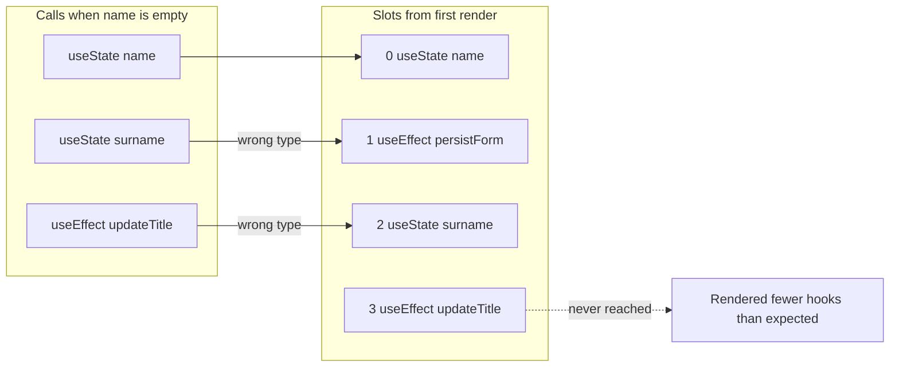

<!-- Generated by scripts/generate-docs.ts from src/catalog. Do not edit by hand. -->

# Why call order matters (Hook slots)

> A visual simulation of React’s per-component list of Hook slots, and how a conditional call shifts them.

🟡 intermediate · React 16.8+ · Rules & Anti-patterns › Rules of Hooks

**Playground:** `npm run dev` → [`#/entry/hook-call-order`](http://localhost:5173/#/entry/hook-call-order)

## Concept

On the first render React creates one slot per Hook call, in order. On every later render the n-th call reads the n-th slot. React never looks at variable names. The demo is a pure simulation of that pairing — no Hooks are actually misused.

## Problem

Without the model, the Rules of Hooks look arbitrary. With it, the failure modes are predictable: shifted slots, silently swapped state, and the two errors React throws.

## Implementation

- [`src/examples/anti-patterns/hookSlots.ts`](../../src/examples/anti-patterns/hookSlots.ts)
- [`src/examples/anti-patterns/HookSlotsDemo.tsx`](../../src/examples/anti-patterns/HookSlotsDemo.tsx)

## Interactive example

- [`src/examples/anti-patterns/HookSlotsDemo.tsx`](../../src/examples/anti-patterns/HookSlotsDemo.tsx)

## Execution flow

1. Mount: calls `[useState name, useEffect persistForm, useState surname, useEffect updateTitle]` create four slots.
2. Next render with an empty name skips `persistForm`: `surname` lands in the effect slot, `updateTitle` in a state slot, and the last slot is never reached.
3. React warns “change in the order of Hooks” in development and throws “Rendered fewer hooks than expected”.
4. Hooks in a loop that reorder keep the same _types_, so React cannot detect it at all — state is silently swapped.

## Diagram: A skipped Hook shifts every later slot

Slots from the first render paired by position with the calls of a render that skipped persistForm.

## Edge cases

- React’s development check compares Hook _types_ only; two `useState` calls swapping places produce no error, just wrong data.
- More calls than slots throws “Rendered more hooks than during the previous render.”

## Testing

Unit tests cover the pairing function and React’s verdict for each case; the demo test toggles the condition and the loop order and reads the result badges.

- [`src/examples/anti-patterns/hookSlots.test.ts`](../../src/examples/anti-patterns/hookSlots.test.ts)
- [`src/examples/anti-patterns/HookSlotsDemo.test.tsx`](../../src/examples/anti-patterns/HookSlotsDemo.test.tsx)

## Related

- [Rules of Hooks](rules-of-hooks.md)
- [How eslint-plugin-react-hooks detects violations](eslint-plugin-react-hooks.md)
- [Rules of Hooks](https://react.dev/reference/rules/rules-of-hooks) (official docs)
- [Why do Hooks rely on call order? (legacy docs)](https://legacy.reactjs.org/docs/hooks-rules.html#explanation) (official docs)
