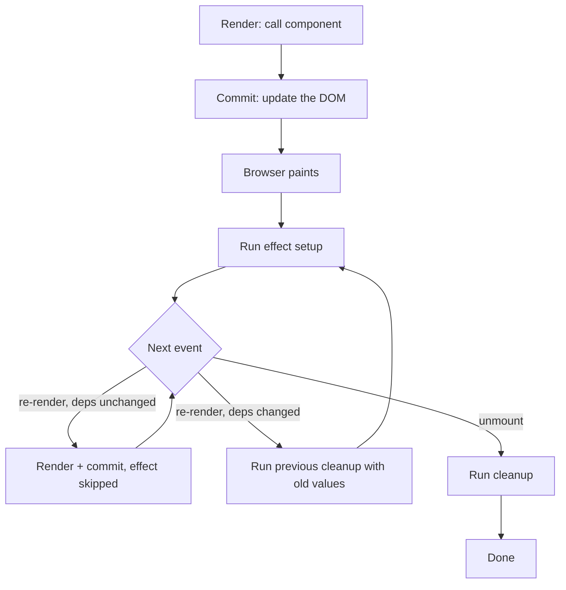

<!-- Generated by scripts/generate-docs.ts from src/catalog. Do not edit by hand. -->

# useEffect — lifecycle & dependency arrays

> Watch mount, update and unmount in a log: no deps vs `[]` vs `[roomId]`, and which cleanup runs when.

🟢 beginner · React 16.8+ · Built-in Hooks › Effects · support: universal

**Playground:** `npm run dev` → [`#/entry/use-effect-fundamentals`](http://localhost:5173/#/entry/use-effect-fundamentals)

## Concept

An effect synchronises a component with something outside React. React runs it after the commit; before running it again (dependencies changed) or on unmount, it runs the cleanup the previous run returned.

## Problem

Rendering must be pure, yet components need to connect, subscribe, start timers or touch browser APIs. Effects give that code a place with a defined lifecycle and an undo step.

## When to use

- Connecting to external systems: sockets, subscriptions, timers, non-React widgets, browser APIs.
- Fetching data when you are not using a framework or data library (with cancellation).

## When not to use

- Transforming data for rendering — compute it during render.
- Responding to a user event — put the code in the event handler.
- Resetting state when a prop changes — use a `key`.

## API

```ts
function useEffect(setup: () => void | (() => void), deps?: DependencyList): void;
```

| Parameter           | Type                       | Description                                                                                          |
| ------------------- | -------------------------- | ---------------------------------------------------------------------------------------------------- |
| `setup`             | `() => void \| Destructor` | Runs after commit; may return a cleanup function.                                                    |
| `deps` _(optional)_ | `unknown[]`                | Omitted: after every commit. `[]`: after mount only. `[a, b]`: when any value changed (`Object.is`). |

## Implementation

- [`src/examples/built-in/effects/UseEffectLifecycleDemo.tsx`](../../src/examples/built-in/effects/UseEffectLifecycleDemo.tsx)

## Interactive example

- [`src/examples/built-in/effects/UseEffectLifecycleDemo.tsx`](../../src/examples/built-in/effects/UseEffectLifecycleDemo.tsx)

## Execution flow

1. Render: React calls the component and records each effect with its dependencies.
2. Commit: React updates the DOM; layout effects run; the browser can paint.
3. Passive effects run (usually after paint): first every pending cleanup, then every pending setup, in declaration order.
4. Re-render with changed deps: the old cleanup runs with the _old_ values, then the new setup.
5. Unmount: every remaining cleanup runs.

## Diagram: Effect lifecycle

Render and commit happen first; effects run after commit. A dependency change runs the previous cleanup before the next setup; unmount runs the last cleanup.



## Common mistakes

### Lying about dependencies

❌ Incorrect:

```tsx
useEffect(() => {
  connect(roomId);
}, []); // roomId missing
```

The effect keeps the first `roomId` forever. `react-hooks/exhaustive-deps` flags this.

✅ Correct:

```tsx
useEffect(() => {
  const c = connect(roomId);
  return () => c.disconnect();
}, [roomId]);
```

### Missing cleanup

❌ Incorrect:

```tsx
useEffect(() => {
  window.addEventListener('resize', onResize);
}, []);
```

The listener survives unmount and Strict Mode attaches it twice.

✅ Correct:

```tsx
useEffect(() => {
  window.addEventListener('resize', onResize);
  return () => window.removeEventListener('resize', onResize);
}, [onResize]);
```

### An async effect function

❌ Incorrect:

```tsx
useEffect(async () => {
  setData(await load());
}, []);
```

An async function returns a promise, not a cleanup; React warns and cannot cancel it.

✅ Correct:

```tsx
useEffect(() => {
  let ignore = false;
  load().then((data) => {
    if (!ignore) setData(data);
  });
  return () => {
    ignore = true;
  };
}, []);
```

## Edge cases

- Objects/functions created during render are new every time: as dependencies they re-run the effect every render. Create them inside the effect or memoise them.
- Effects triggered by a discrete event (click) may be flushed before paint; do not rely on "after paint" for correctness.

## Browser support

Effects never run during server rendering.

## Testing

The demo test reads the log in chronological order and asserts mount order, that an unrelated re-render only re-runs the no-deps effect, that a dependency change runs the old cleanup before the new setup, and that unmount runs every cleanup.

- [`src/examples/built-in/effects/UseEffectLifecycleDemo.test.tsx`](../../src/examples/built-in/effects/UseEffectLifecycleDemo.test.tsx)

## Production considerations

- Every setup needs a symmetrical cleanup; Strict Mode in development verifies it.
- Prefer a data library (TanStack Query, SWR) or framework loaders for fetching.

## Related

- [useEffect — event listeners, timers & browser APIs](use-effect-subscriptions.md)
- [useEffect — Strict Mode double mount](use-effect-strict-mode.md)
- [useEffect — race conditions & AbortController](use-effect-race-conditions.md)
- [useLayoutEffect — measure before paint](use-layout-effect.md)
- [You might not need an effect](you-might-not-need-an-effect.md)
- [useEffect](https://react.dev/reference/react/useEffect) (official docs)
- [Synchronizing with effects](https://react.dev/learn/synchronizing-with-effects) (official docs)
- [Lifecycle of reactive effects](https://react.dev/learn/lifecycle-of-reactive-effects) (official docs)
