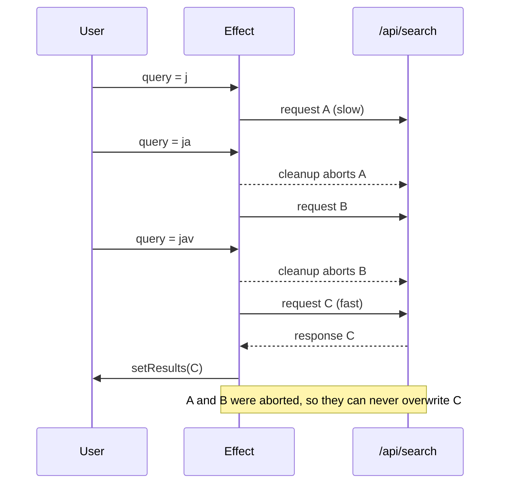

<!-- Generated by scripts/generate-docs.ts from src/catalog. Do not edit by hand. -->

# useEffect — race conditions & AbortController

> With inverted latency, the buggy search shows a stale response; aborting in the cleanup guarantees only the latest query wins.

🟡 intermediate · React 16.8+ · Built-in Hooks › Effects · support: client-only

**Playground:** `npm run dev` → [`#/entry/use-effect-race-conditions`](http://localhost:5173/#/entry/use-effect-race-conditions)

## Concept

Each effect run starts a request for its own query. The cleanup — which runs before the next run — aborts that request and sets an `ignore` flag, so a late response from an outdated query can never call `setState`.

## Problem

Responses arrive in any order. Typing "j" → "ja" → "jav" against `/api/search` (shorter queries are slower) makes the "j" response arrive last and overwrite the "jav" results.

## When to use

- Any effect that starts async work whose result depends on props/state that can change before it finishes.

## When not to use

- Production data fetching — TanStack Query or SWR handle cancellation, caching, deduplication and retries; frameworks provide loaders.

## API

```ts
useEffect(() => {
  const controller = new AbortController();
  fetch(url, { signal: controller.signal }).then(apply).catch(ignoreAbort);
  return () => controller.abort();
}, [url]);
```

## Implementation

- [`src/examples/built-in/effects/UseEffectRaceConditionDemo.tsx`](../../src/examples/built-in/effects/UseEffectRaceConditionDemo.tsx)

## Interactive example

- [`src/examples/built-in/effects/UseEffectRaceConditionDemo.tsx`](../../src/examples/built-in/effects/UseEffectRaceConditionDemo.tsx)

## Execution flow

1. Query "j": effect run 1 starts request A.
2. Query "ja": cleanup 1 aborts A (its promise rejects with AbortError, ignored); run 2 starts B.
3. Query "jav": cleanup 2 aborts B; run 3 starts C.
4. Only C can call `setState`. In the buggy version A, B and C all apply, in arrival order.

## Diagram: Cancelling superseded requests

Each query change runs the previous cleanup, which aborts the in-flight request; only the latest response is applied.



## Common mistakes

### No cleanup

❌ Incorrect:

```tsx
useEffect(() => {
  fetch(`/api/search?q=${q}`)
    .then((r) => r.json())
    .then(setResults);
}, [q]);
```

Whichever response arrives last wins, even if its query is outdated.

✅ Correct:

```tsx
useEffect(() => {
  const controller = new AbortController();
  fetch(`/api/search?q=${q}`, { signal: controller.signal })
    .then((r) => r.json())
    .then(setResults)
    .catch((e) => {
      if (!controller.signal.aborted) setError(e);
    });
  return () => controller.abort();
}, [q]);
```

### Treating an abort as an error

❌ Incorrect:

```tsx
.catch((error) => setError(error))
```

Every superseded request would flash an error.

✅ Correct:

```tsx
.catch((error) => { if (!controller.signal.aborted) setError(error); })
```

### Storing `loading` with a synchronous setState in the effect

❌ Incorrect:

```tsx
useEffect(() => {
  setLoading(true);
  /* fetch … */
}, [q]);
```

An extra render per change; `react-hooks/set-state-in-effect` flags it.

✅ Correct:

```tsx
const loading = applied.query !== q; // derive it from the last applied response
```

## Edge cases

- The `ignore` flag also covers work that cannot be aborted (other promises, `response.json()` already in flight).
- An empty query starts no request; the panel derives "no results" in render.

## Testing

An MSW `server.use` override gives fixed latencies (j 150 ms, ja 90 ms, jav 10 ms). The test types "jav", waits for the buggy panel to end on "j" and asserts the fixed panel shows only "jav" results, logged aborts for "j" and "ja", and no applied stale response.

- [`src/examples/built-in/effects/UseEffectRaceConditionDemo.test.tsx`](../../src/examples/built-in/effects/UseEffectRaceConditionDemo.test.tsx)

## Production considerations

- Debounce user input in addition to cancelling (fewer requests).
- Pass the `signal` to every layer (fetch wrappers, SDKs) so aborts actually stop work.

## Related

- [useEffect — lifecycle & dependency arrays](use-effect-fundamentals.md)
- [useEffect — Strict Mode double mount](use-effect-strict-mode.md)
- [You might not need an effect](you-might-not-need-an-effect.md)
- [useEffect: fetching data with effects](https://react.dev/reference/react/useEffect#fetching-data-with-effects) (official docs)
- [MDN: AbortController](https://developer.mozilla.org/en-US/docs/Web/API/AbortController) (official docs)
