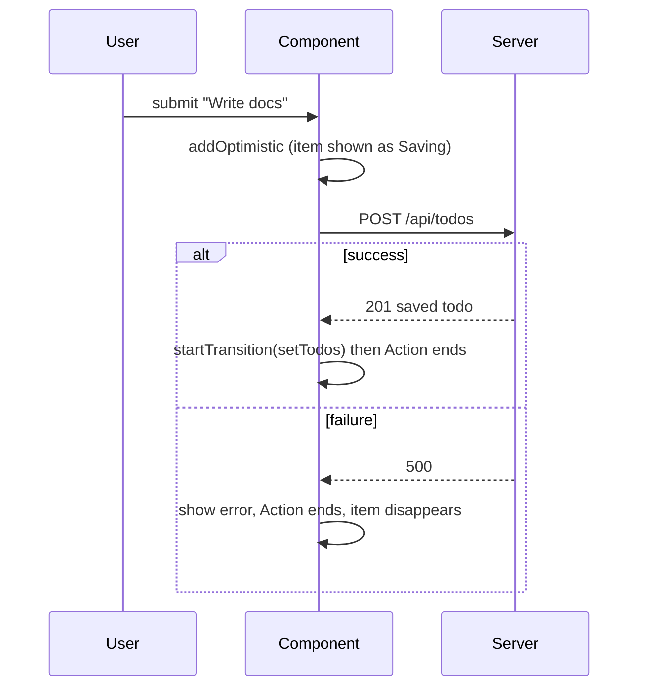

<!-- Generated by scripts/generate-docs.ts from src/catalog. Do not edit by hand. -->

# useOptimistic

> Show the expected result of an Action immediately; React drops it automatically when the Action ends.

🔴 advanced · React 19.0+ · Built-in Hooks › Modern React (19+) · support: universal

**Playground:** `npm run dev` → [`#/entry/use-optimistic`](http://localhost:5173/#/entry/use-optimistic)

## Concept

`const [optimistic, addOptimistic] = useOptimistic(state, reducer)`. While an Action is running, `addOptimistic(input)` renders `reducer(current, input)`. When the Action finishes React renders `state` again — so success shows the saved data and failure “rolls back” for free.

## Problem

Waiting for the server makes simple interactions feel slow; hand-written optimistic updates need manual rollback and are easy to leave in an inconsistent state.

## When to use

- Likes, adding list items, renames — anything that usually succeeds and is cheap to undo visually.
- Inside an Action: a form `action`, `startTransition`, or `useActionState`’s dispatch.

## When not to use

- Outside an Action — React warns and the optimistic value only flashes.
- Operations whose failure is common or costly (payments): show a pending state instead.
- Cache-wide optimistic updates across many components — TanStack Query’s `onMutate` / SWR’s `mutate` manage cache rollback for you.

## API

```ts
function useOptimistic<State, Action>(
  passthrough: State,
  reducer: (state: State, action: Action) => State,
): [State, (action: Action) => void];
```

**Returns:** The optimistic state (equal to `passthrough` when no Action is pending) and the setter.

## Implementation

- [`src/examples/built-in/modern/UseOptimisticDemo.tsx`](../../src/examples/built-in/modern/UseOptimisticDemo.tsx)
- [`src/examples/built-in/modern/api.ts`](../../src/examples/built-in/modern/api.ts)

## Interactive example

- [`src/examples/built-in/modern/UseOptimisticDemo.tsx`](../../src/examples/built-in/modern/UseOptimisticDemo.tsx)

## Execution flow

1. Submit: the form action runs in a transition; `addOptimistic(title)` immediately renders the placeholder (“Saving…”).
2. Success: `startTransition(() => setTodos([...todos, saved]))` — the real state and the end of the Action commit together, replacing the placeholder.
3. Failure: the Action ends without updating `todos`; React renders the real list, so the placeholder disappears. The caught error is shown separately.

## Diagram: Optimistic add with rollback

The optimistic item lives only while the Action is pending.



## Common mistakes

### Forgetting startTransition after await

❌ Incorrect:

```tsx
const saved = await createTodo(title);
setTodos((t) => [...t, saved]);
```

Updates after `await` are not part of the Action, so the saved item and the end of the optimistic state can commit separately and flicker.

✅ Correct:

```tsx
const saved = await createTodo(title);
startTransition(() => setTodos((t) => [...t, saved]));
```

## Edge cases

- If `state` changes while the Action is pending, React re-runs the reducer on top of the new state.
- Optimistic ids must be unique and distinguishable from server ids (`optimistic:<title>` in the demo).

## Testing

An MSW gate keeps POST /api/todos pending: the test sees the optimistic item and “Saving…”, opens the gate with a 500 and asserts the error message and rollback; a success path and the default “fail” rule are covered too.

- [`src/examples/built-in/modern/UseOptimisticDemo.test.tsx`](../../src/examples/built-in/modern/UseOptimisticDemo.test.tsx)

## Related

- [useActionState](use-action-state.md)
- [<form action={fn}> Actions](form-actions.md)
- [Async transitions (Actions)](use-transition-actions.md)
- [useOptimisticMutation](../custom-hooks/use-optimistic-mutation.md)
- [useOptimistic](https://react.dev/reference/react/useOptimistic) (official docs)
- [React 19 release post](https://react.dev/blog/2024/12/05/react-19) (official docs)
