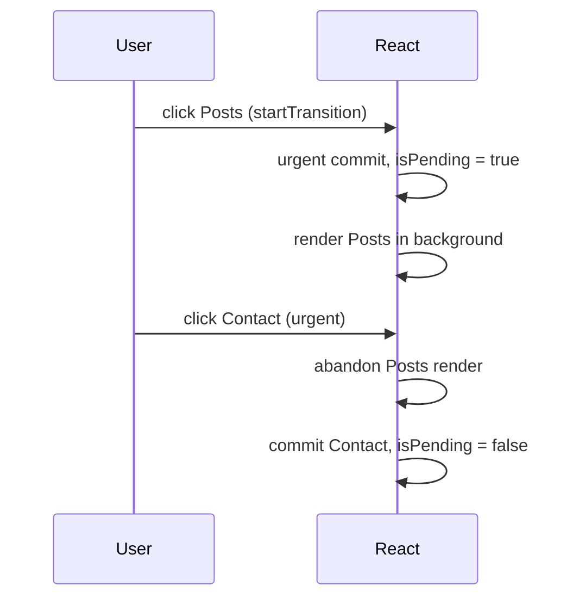

<!-- Generated by scripts/generate-docs.ts from src/catalog. Do not edit by hand. -->

# useTransition

> Mark an update as non-urgent so slow rendering never blocks typing or clicking, with an isPending flag.

🔴 advanced · React 18.0+ · Built-in Hooks › Performance · support: universal

**Playground:** `npm run dev` → [`#/entry/use-transition`](http://localhost:5173/#/entry/use-transition)

## Concept

`const [isPending, startTransition] = useTransition()`. State updates inside `startTransition(fn)` render at low priority in the background; React keeps showing the current UI (with `isPending === true`) and throws the background render away if an urgent update arrives.

## Problem

Switching to a tab that renders hundreds of slow components freezes the page: clicks and keystrokes wait for the render to finish.

## When to use

- Navigation-like updates that render a lot (tabs, routes, filters over big lists).
- Updates that may suspend, to keep already-visible content instead of showing a Suspense fallback.
- Since React 19, async work: `startTransition(async () => …)` — see Async transitions (Actions).

## When not to use

- Controlled input values — the input itself must update urgently (update it outside the transition, as the demo does).
- To reduce network requests — transitions change rendering priority, not how often code runs; debounce for that.
- When the slowness is in an effect or a synchronous calculation outside rendering — transitions only interrupt between components.

## API

```ts
function useTransition(): [
  isPending: boolean,
  startTransition: (action: () => void | Promise<void>) => void,
];
```

**Returns:** `isPending` (true while a transition is in progress) and a stable `startTransition` function.

## Implementation

- [`src/examples/built-in/performance/UseTransitionDemo.tsx`](../../src/examples/built-in/performance/UseTransitionDemo.tsx)
- [`src/examples/built-in/performance/workload.ts`](../../src/examples/built-in/performance/workload.ts)

## Interactive example

- [`src/examples/built-in/performance/UseTransitionDemo.tsx`](../../src/examples/built-in/performance/UseTransitionDemo.tsx)

## Execution flow

1. Click: `startTransition` marks the updates inside it as Transition updates. React first commits an urgent render with `isPending = true`.
2. React renders the new state in the background, yielding to the browser between components.
3. If an urgent update arrives (another click, a keystroke) the background render is abandoned and restarted with the latest state.
4. When it completes, React commits it and `isPending` becomes false in the same commit.

## Diagram: An interrupted transition

An urgent click arrives while a transition is rendering in the background.



## Common mistakes

### Putting the input value in the transition

❌ Incorrect:

```tsx
onChange={(e) => startTransition(() => setQuery(e.target.value))}
```

The input renders the old value until the transition completes, so typing feels broken.

✅ Correct:

```tsx
onChange={(e) => {
  setQuery(e.target.value);
  startTransition(() => setListQuery(e.target.value));
}}
```

## Edge cases

- Pending state is only observable outside `act()` in tests; the test leaves the act environment and uses native clicks.
- React 19.3 renders independent transitions separately, so a slow one no longer holds up unrelated ones.

## Testing

The tab test asserts the “Rendering in the background…” indicator and the still-visible previous panel, then the finished posts list. A second test switches transitions off; a third filters 2,000 rows behind a transition.

- [`src/examples/built-in/performance/UseTransitionDemo.test.tsx`](../../src/examples/built-in/performance/UseTransitionDemo.test.tsx)

## Related

- [useDeferredValue](use-deferred-value.md)
- [Async transitions (Actions)](use-transition-actions.md)
- [Debounce vs deferred rendering](debounce-vs-deferred.md)
- [Rendering large lists](large-lists.md)
- [useTransition](https://react.dev/reference/react/useTransition) (official docs)
- [startTransition](https://react.dev/reference/react/startTransition) (official docs)
