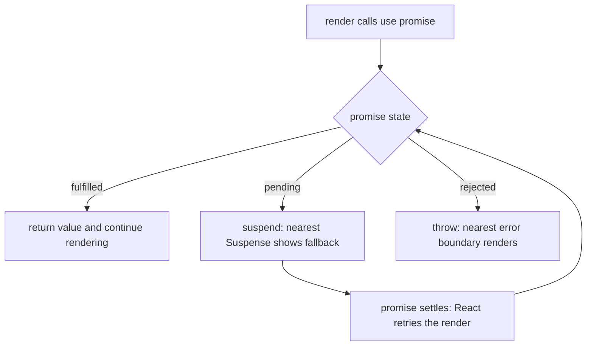

<!-- Generated by scripts/generate-docs.ts from src/catalog. Do not edit by hand. -->

# use

> Read a promise (suspending until it settles) or a context — and, unlike Hooks, call it conditionally.

🔴 advanced · React 19.0+ · Built-in Hooks › Modern React (19+) · support: universal

**Playground:** `npm run dev` → [`#/entry/use`](http://localhost:5173/#/entry/use)

## Concept

`use(resource)` reads the value of a Promise or a Context. For a pending promise the component suspends (the nearest `<Suspense>` shows its fallback); a rejected promise throws to the nearest error boundary. `use` is an API, not a Hook: it may be called inside `if` and loops.

## Problem

Fetching in effects means loading flags, race handling and waterfalls in every component. `useContext` cannot be called conditionally, which forces reading context you might not need.

## When to use

- Reading a promise that was created **outside render**: in an event handler (as the demo does), a router loader, a framework, a cache keyed by id, or a Server Component.
- Reading context only on some code paths (`if (showTheme) use(ThemeContext)`).

## When not to use

- A promise created in the component body — a new promise every render suspends forever. React warns about uncached promises.
- As a full data layer: `use` has no caching, deduplication, revalidation or retries. Prefer TanStack Query / SWR or your framework’s loaders, which can integrate with Suspense.
- Inside `try/catch` — not supported; use an error boundary.

## API

```ts
function use<T>(usable: Promise<T> | Context<T>): T;
```

**Returns:** The resolved value of the promise, or the context value.

## Implementation

- [`src/examples/built-in/modern/UseDemo.tsx`](../../src/examples/built-in/modern/UseDemo.tsx)
- [`src/examples/built-in/modern/api.ts`](../../src/examples/built-in/modern/api.ts)
- [`src/examples/built-in/modern/ErrorBoundary.tsx`](../../src/examples/built-in/modern/ErrorBoundary.tsx)
- [`src/mocks/extra/modernHandlers.ts`](../../src/mocks/extra/modernHandlers.ts)

## Interactive example

- [`src/examples/built-in/modern/UseDemo.tsx`](../../src/examples/built-in/modern/UseDemo.tsx)

## Execution flow

1. Render: `use(promise)` returns the value if the promise already resolved; otherwise React suspends the component and shows the closest Suspense fallback.
2. When the promise settles React retries the render. A rejection is thrown to the nearest error boundary.
3. Inside a transition (the demo’s default), already-visible content stays on screen with `isPending` instead of falling back.

## Diagram: What use(promise) does during render

A promise read with use either returns a value, suspends, or throws to an error boundary.



## Common mistakes

### Creating the promise during render

❌ Incorrect:

```tsx
function Profile({ id }) {
  const user = use(fetch(`/api/users/${id}`).then((r) => r.json()));
}
```

Every render creates a new promise, so the component suspends again and again.

✅ Correct:

```tsx
const cache = new Map();
function getUser(id) {
  if (!cache.has(id)) cache.set(id, fetchUser(id));
  return cache.get(id);
}
// in an event handler: setUserPromise(getUser(id));
```

## Edge cases

- The module cache evicts rejected promises so “Try again” can refetch; the error boundary resets when the promise changes (`resetKey`).
- In tests a synchronous `act()` drops renders that suspend on a pending promise; the tests leave the act environment and hold responses with an MSW “gate”.

## Browser support

With streaming SSR / Server Components, a promise created on the server can be passed to a Client Component and read with `use`. Reading context with `use` is not supported in Server Components.

## Testing

Four tests: fallback then content without a transition, stale content plus `isPending` with one, conditional `use(Context)` updating with the provider, and a 404 shown by the error boundary followed by a successful retry.

- [`src/examples/built-in/modern/UseDemo.test.tsx`](../../src/examples/built-in/modern/UseDemo.test.tsx)

## Related

- [Suspense + error boundaries for data](suspense-error-boundary.md)
- [Async transitions (Actions)](use-transition-actions.md)
- [useContext — shared values, multiple contexts & React 19 providers](use-context.md)
- [TanStack Query (server state)](../state-management/tanstack-query.md)
- [use](https://react.dev/reference/react/use) (official docs)
- [React 19 release post](https://react.dev/blog/2024/12/05/react-19) (official docs)
