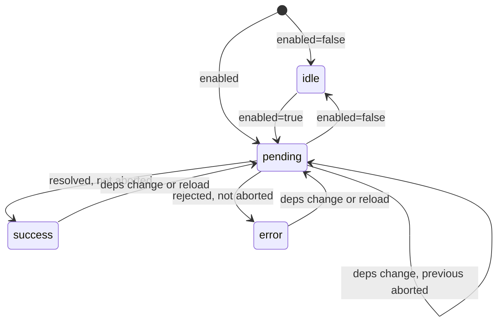

<!-- Generated by scripts/generate-docs.ts from src/catalog. Do not edit by hand. -->

# useAsync

> Run a promise-returning function when deps change, with abort, stale-result protection and a typed status union.

🟡 intermediate · React 16.8+ · Custom Hooks › Data fetching & async · support: universal

**Playground:** `npm run dev` → [`#/entry/use-async`](http://localhost:5173/#/entry/use-async)

## Concept

Calls `fn(signal)` after every commit in which `deps` changed and exposes `{ status: "idle" | "pending" | "success" | "error", data, error }` as a discriminated union. The previous run’s signal is aborted, and an aborted run can never write state.

## Problem

Hand-written fetch effects show stale responses when inputs change quickly (a slow old request finishes last), set state after unmount, forget to abort, and model loading/error/data as three loosely related booleans.

## When to use

- Any async value derived from props/state: a search, a detail view, a computed report.
- Composing several requests (`Promise.all`) under one status and one abort signal.

## When not to use

- Production server state (caching, deduplication, background refetch, SSR hydration) — use [TanStack Query](https://tanstack.com/query/latest), [SWR](https://swr.vercel.app/) or your framework’s data loader (Next.js, React Router).
- User-triggered actions (submit, delete) — use `useAsyncFn`, which runs only when called.

## API

```ts
function useAsync<T>(
  fn: (signal: AbortSignal) => Promise<T>,
  deps: DependencyList,
  options?: { enabled?: boolean; keepPreviousData?: boolean },
): AsyncState<T> & { reload: () => void };
```

| Parameter                               | Type                                  | Description                                                              |
| --------------------------------------- | ------------------------------------- | ------------------------------------------------------------------------ |
| `fn`                                    | `(signal: AbortSignal) => Promise<T>` | May be inline; the latest is called. Pass `signal` to `fetch`.           |
| `deps`                                  | `DependencyList`                      | Re-run when any item changes (`Object.is`). List every value `fn` reads. |
| `options.enabled` _(optional)_          | `boolean`                             | `false` → `idle`, aborts in-flight work. Default `true`.                 |
| `options.keepPreviousData` _(optional)_ | `boolean`                             | Keep the last `data` while pending. Default `false`.                     |

**Returns:** The state union plus a stable `reload()`. Narrow on `status`: in `success`, `data` is `T`; in `error`, `error` is an `Error`.

## Implementation

- [`src/hooks/async/useAsync.ts`](../../src/hooks/async/useAsync.ts)
- [`src/hooks/async/fetchJson.ts`](../../src/hooks/async/fetchJson.ts)
- [`src/hooks/state/useLatest.ts`](../../src/hooks/state/useLatest.ts)

## Interactive example

- [`src/examples/custom-hooks/async/UseAsyncDemo.tsx`](../../src/examples/custom-hooks/async/UseAsyncDemo.tsx)

## Execution flow

1. Render: deps are compared with the previous render; a change bumps a version (render-time state adjustment), so this render already reports `pending`.
2. Effect (keyed on the version): a new `AbortController` is created and `fn(signal)` called.
3. Settle: the result is stored only if the signal was not aborted.
4. Cleanup (deps change, `reload`, disable, unmount): the controller aborts — late results are dropped.

## Diagram: Status transitions

The discriminated union and what moves between states.



## Common mistakes

### Ignoring out-of-order responses

❌ Incorrect:

```tsx
useEffect(() => {
  fetch(`/api/search?q=${q}`)
    .then((r) => r.json())
    .then(setResults);
}, [q]);
```

If “ja” answers after “jav”, the UI shows results for “ja” while the input says “jav”.

✅ Correct:

```tsx
const results = useAsync((signal) => fetchJson(`/api/search?q=${q}`, { signal }), [q]);
```

### Three independent flags

❌ Incorrect:

```tsx
const [loading, setLoading] = useState(false);
const [error, setError] = useState(null);
const [data, setData] = useState(null);
```

Impossible combinations (loading with an error and stale data) become representable and render bugs follow.

## Edge cases

- Synchronous throws inside `fn` become an `error` state.
- In Strict Mode development the effect runs twice; the first run is aborted immediately.
- Errors are normalised to `Error` instances (strings and objects are wrapped).

## Browser support

Renders `pending` on the server; runs only in the browser.

## Testing

Tests force races with deferred promises, assert `signal.aborted` on deps change and unmount, prove no state updates after unmount, and cover `enabled`, `reload` and `keepPreviousData`.

- [`src/hooks/async/useAsync.test.tsx`](../../src/hooks/async/useAsync.test.tsx)
- [`src/hooks/async/async.ssr.test.tsx`](../../src/hooks/async/async.ssr.test.tsx)
- [`src/examples/custom-hooks/async/AsyncDemos.test.tsx`](../../src/examples/custom-hooks/async/AsyncDemos.test.tsx)

## Production considerations

- Pass the signal all the way to `fetch` so aborted requests stop using bandwidth.
- Prefer a cache library once several components need the same data.

## Related

- [useFetch](use-fetch.md)
- [useAsyncFn](use-async-fn.md)
- [useLatest](use-latest.md)
- [Fetching data with Effects](https://react.dev/reference/react/useEffect#fetching-data-with-effects) (official docs)
- [Adjusting state when a prop changes](https://react.dev/learn/you-might-not-need-an-effect#adjusting-some-state-when-a-prop-changes) (official docs)
- [MDN: AbortController](https://developer.mozilla.org/en-US/docs/Web/API/AbortController) (official docs)
