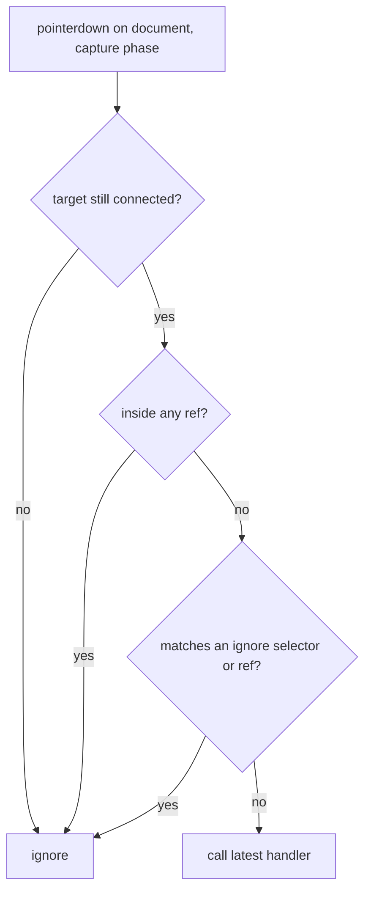

<!-- Generated by scripts/generate-docs.ts from src/catalog. Do not edit by hand. -->

# useClickOutside

> Close popovers and menus when the user presses outside one or more elements.

🟡 intermediate · React 16.8+ · Custom Hooks › Browser & DOM · support: client-only

**Playground:** `npm run dev` → [`#/entry/use-click-outside`](http://localhost:5173/#/entry/use-click-outside)

## Concept

Listens for presses on `document` (capture phase) and calls your handler when the pressed node is outside every element in `refs` and not inside an `ignore` selector or ref.

## Problem

Hand-rolled versions listen in the bubble phase (missing presses when something calls `stopPropagation()`), check a single element (breaking portalled menus), re-subscribe on every render, or close the menu and immediately reopen it when its own toggle button is pressed.

## When to use

- Dismissing non-modal popovers, dropdowns, context menus and inline editors.
- Several elements form one "inside": a trigger plus a menu rendered in a portal.

## When not to use

- Modal dialogs — use `<dialog>`/`showModal()` or a backdrop element whose click closes the dialog.
- As the only way to close: keyboard users never click outside. Pair with Escape and, for non-modal popovers, `useFocusWithin`.
- The native Popover API (`popover` attribute) gives light-dismiss for free in current browsers.

## API

```ts
function useClickOutside(
  refs: RefObject<Element | null> | RefObject<Element | null>[],
  handler: (event: MouseEvent | TouchEvent) => void,
  options?: {
    enabled?: boolean;
    events?: ('pointerdown' | 'mousedown' | 'touchstart' | 'click')[];
    ignore?: (string | RefObject<Element | null>)[];
  },
): void;
```

| Parameter                      | Type                       | Description                                                               |
| ------------------------------ | -------------------------- | ------------------------------------------------------------------------- |
| `refs`                         | `RefObject \| RefObject[]` | Element(s) that count as inside. Read at event time.                      |
| `handler`                      | `(event) => void`          | Called for outside presses. The latest one is always used.                |
| `options.enabled` _(optional)_ | `boolean`                  | Attach listeners only while `true` (e.g. while open). Default `true`.     |
| `options.events` _(optional)_  | `string[]`                 | Defaults to `pointerdown` (fallback: `mousedown` + `touchstart`).         |
| `options.ignore` _(optional)_  | `(string \| RefObject)[]`  | Selectors (matched with `closest()`) or refs that never count as outside. |

**Returns:** Nothing.

## Implementation

- [`src/hooks/browser/useClickOutside.ts`](../../src/hooks/browser/useClickOutside.ts)
- [`src/hooks/state/useLatest.ts`](../../src/hooks/state/useLatest.ts)

## Interactive example

- [`src/examples/custom-hooks/browser/UseClickOutsideDemo.tsx`](../../src/examples/custom-hooks/browser/UseClickOutsideDemo.tsx)

## Execution flow

1. Render: `handler`, `refs` and `ignore` are stored in refs via `useLatest`; `events` is reduced to a string key.
2. Effect (when `enabled`): one capture-phase, passive listener per event type is added to `document`.
3. Event: the target is checked against `composedPath()` and `contains()` for every ref, then against `ignore`; only then is the handler called.
4. Cleanup (unmount, `enabled` → false, events change): the same listeners are removed.

## Diagram: Deciding whether a press is outside

The checks the capture-phase listener runs for every press.



## Common mistakes

### Toggle button fights the hook

❌ Incorrect:

```tsx
useClickOutside(menuRef, () => setOpen(false));
<button onClick={() => setOpen((o) => !o)}>Menu</button>;
```

Pressing the button is "outside" the menu: the hook closes it, then the click handler toggles it open again.

✅ Correct:

```tsx
useClickOutside(menuRef, () => setOpen(false), { ignore: [buttonRef] });
```

### Listening for `click` in the bubble phase

❌ Incorrect:

```tsx
document.addEventListener('click', onDocumentClick);
```

A `stopPropagation()` anywhere inside hides the click, and the clicked element may already be unmounted by React when the event reaches `document`.

## Edge cases

- Presses on nodes already removed from the document are ignored (they cannot be judged reliably).
- Shadow DOM: `composedPath()` is checked, so presses inside web components count as inside their host.
- The listener is passive, so the handler cannot `preventDefault()` the press.
- iframes: presses inside an iframe never reach the parent document.

## Browser support

Pointer Events everywhere modern; falls back to `mousedown` + `touchstart` without `PointerEvent`. No-op on the server.

## Testing

Tests cover multiple refs, selector and ref `ignore`, `stopPropagation` inside (capture still fires), latest handler without re-subscribing, custom events, the no-PointerEvent fallback, detached targets and listener removal.

- [`src/hooks/browser/useClickOutside.test.tsx`](../../src/hooks/browser/useClickOutside.test.tsx)
- [`src/examples/custom-hooks/browser/UseClickOutsideDemo.test.tsx`](../../src/examples/custom-hooks/browser/UseClickOutsideDemo.test.tsx)
- [`src/hooks/browser/browser.ssr.test.tsx`](../../src/hooks/browser/browser.ssr.test.tsx)

## Production considerations

- Pass `enabled: open` so closed popovers cost nothing.
- Also close on Escape and return focus to the trigger.

## Related

- [useEventListener](use-event-listener.md)
- [useFocusWithin](use-focus-within.md)
- [useLatest](use-latest.md)
- [MDN: pointerdown event](https://developer.mozilla.org/en-US/docs/Web/API/Element/pointerdown_event) (official docs)
- [MDN: Event.composedPath()](https://developer.mozilla.org/en-US/docs/Web/API/Event/composedPath) (official docs)
