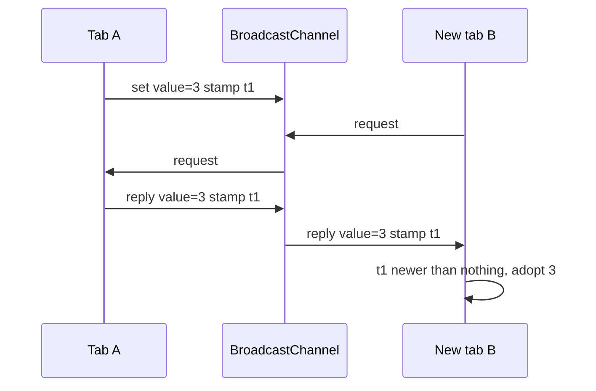

<!-- Generated by scripts/generate-docs.ts from src/catalog. Do not edit by hand. -->

# useCrossTabState

> `useState` shared live between open tabs via BroadcastChannel — nothing persisted.

🔴 advanced · React 18.0+ · Custom Hooks › Storage & persistence · support: browser-limited

**Playground:** `npm run dev` → [`#/entry/use-cross-tab-state`](http://localhost:5173/#/entry/use-cross-tab-state)

## Concept

Local React state plus a tiny protocol over `useBroadcastChannel`: updates are broadcast as `set` with a timestamp; a newly opened tab sends `request` and adopts the newest `reply`. Conflicts resolve last-writer-wins.

## Problem

Sometimes tabs must agree on a value that should **not** outlive the session or touch disk — and `useLocalStorage` would persist it, serialise it to a string and count it against the quota.

## When to use

- Ephemeral shared UI state: the current slide in a presenter view, a “follow along” selection, a temporary filter across two windows.
- Values that do not serialise to JSON well (`Map`, `Set`, `Date`, `Blob`) — they are structured-cloned.

## When not to use

- State that must survive closing all tabs — use `useLocalStorage`.
- Per-tab state — use `useState` or `useSessionStorage`.
- Collaborative editing across devices — that needs a server (CRDTs, WebSocket).

## API

```ts
function useCrossTabState<T>(
  channelName: string,
  initialValue: T | (() => T),
  options?: { validate?: (value: unknown) => value is T; onError?: (error: Error) => void },
): readonly [value: T, setValue: SetStorageValue<T>];
```

| Parameter                       | Type                    | Description                                    |
| ------------------------------- | ----------------------- | ---------------------------------------------- |
| `channelName`                   | `string`                | Tabs using the same name share the value.      |
| `initialValue`                  | `T \| (() => T)`        | Used until a tab replies or an update arrives. |
| `options.validate` _(optional)_ | `(value) => value is T` | Guards incoming values.                        |

**Returns:** A `useState`-like tuple.

## Implementation

- [`src/hooks/storage/useCrossTabState.ts`](../../src/hooks/storage/useCrossTabState.ts)
- [`src/hooks/storage/useBroadcastChannel.ts`](../../src/hooks/storage/useBroadcastChannel.ts)

## Interactive example

- [`src/examples/custom-hooks/storage/UseCrossTabStateDemo.tsx`](../../src/examples/custom-hooks/storage/UseCrossTabStateDemo.tsx)

## Execution flow

1. Mount: the channel opens and a `request` is posted; open tabs with a value reply.
2. `setValue` stamps `{ at, tab }`, updates locally and broadcasts `set`.
3. Incoming `set`/`reply` messages are applied only if their stamp is newer, so all tabs converge.
4. Unmount: the channel closes.

## Diagram: Late-joiner sync

How a new tab catches up without any persistence.



## Edge cases

- Two tabs writing in the same millisecond: ties break by tab id, so both end up with the same value.
- Reloading the only open tab resets to `initialValue` — by design.
- Clock changes between writes can reorder them; acceptable for UI state, not for data integrity.

## Browser support

Behaves like plain `useState` without BroadcastChannel and on the server.

## Testing

Tests connect several hooks through Node’s BroadcastChannel: broadcast updates, late-joiner sync, structured-cloned Maps/Dates, convergence and validation, plus the unsupported fallback.

- [`src/hooks/storage/useCrossTabState.test.tsx`](../../src/hooks/storage/useCrossTabState.test.tsx)
- [`src/hooks/storage/persistence.ssr.test.tsx`](../../src/hooks/storage/persistence.ssr.test.tsx)
- [`src/examples/custom-hooks/storage/StorageDemos.test.tsx`](../../src/examples/custom-hooks/storage/StorageDemos.test.tsx)

## Production considerations

- Keep values small; every update is cloned to every tab.
- Never broadcast secrets: any same-origin script can listen.

## Related

- [useBroadcastChannel](use-broadcast-channel.md)
- [useLocalStorage](use-local-storage.md)
- [useSessionStorage](use-session-storage.md)
- [MDN: Broadcast Channel API](https://developer.mozilla.org/en-US/docs/Web/API/Broadcast_Channel_API) (official docs)
