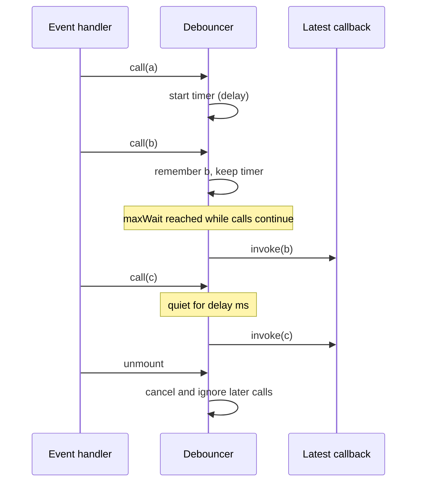

<!-- Generated by scripts/generate-docs.ts from src/catalog. Do not edit by hand. -->

# useDebouncedCallback

> A stable debounced function with leading/trailing edges, `maxWait`, `cancel`, `flush` and `isPending`.

🟡 intermediate · React 16.8+ · Custom Hooks › Timing & scheduling · support: universal

**Playground:** `npm run dev` → [`#/entry/use-debounced-callback`](http://localhost:5173/#/entry/use-debounced-callback)

## Concept

A framework-agnostic debounce engine (lodash algorithm) is created once per component. A layout effect hands it the newest callback and options after every commit, so the returned function never changes identity and never calls a stale closure.

## Problem

`useMemo(() => debounce(fn, 300), [fn])` recreates the debouncer (losing pending calls) whenever `fn` changes, keeps firing after unmount, and closes over stale props when `fn` is omitted from the dependencies.

## When to use

- Autosave, analytics, resize/scroll handlers that do expensive work, sending a request after typing stops.

## When not to use

- You only need a debounced _value_ — use `useDebounce`.
- Work that must happen at regular intervals during the activity — use `useThrottledCallback`.

## API

```ts
function useDebouncedCallback<Args extends unknown[]>(
  callback: (...args: Args) => void,
  delayMs: number,
  options?: { leading?: boolean; trailing?: boolean; maxWait?: number },
): DebouncedFunction<Args>;
```

| Parameter                       | Type                | Description                                                           |
| ------------------------------- | ------------------- | --------------------------------------------------------------------- |
| `callback`                      | `(...args) => void` | May change every render; the latest one runs.                         |
| `delayMs`                       | `number`            | Quiet period (negative values count as 0).                            |
| `options.leading` _(optional)_  | `boolean`           | Invoke on the first call of a burst (default false).                  |
| `options.trailing` _(optional)_ | `boolean`           | Invoke after the burst with the latest arguments (default true).      |
| `options.maxWait` _(optional)_  | `number`            | Upper bound on how long a call can be postponed (clamped to ≥ delay). |

**Returns:** A stable function with `cancel()`, `flush()` and `isPending()` (not reactive — read it in handlers).

## Implementation

- [`src/hooks/timing/useDebouncedCallback.ts`](../../src/hooks/timing/useDebouncedCallback.ts)
- [`src/hooks/timing/debouncer.ts`](../../src/hooks/timing/debouncer.ts)

## Interactive example

- [`src/examples/custom-hooks/timing/UseDebouncedCallbackDemo.tsx`](../../src/examples/custom-hooks/timing/UseDebouncedCallbackDemo.tsx)

## Execution flow

1. Render: returns the same function every time; nothing is read from refs.
2. Layout effect: the engine receives the latest callback and options; if the delay/edges changed, a scheduled timer is re-evaluated (measured from the last call).
3. Call: records arguments; leading edge invokes immediately when enabled; a single timer handles the trailing edge and `maxWait`.
4. Unmount: the engine is disabled — pending work is cancelled and later calls are ignored. (Strict Mode re-enables it on the simulated remount.)

## Diagram: Debounce with maxWait

A burst of calls produces one trailing invocation, or one per maxWait while it continues.



## Common mistakes

### Recreating the debouncer on every render

❌ Incorrect:

```tsx
const save = debounce((text) => api.save(text), 500);
```

Each render creates a new debouncer with its own timer, so nothing is debounced and old timers still fire after unmount.

✅ Correct:

```tsx
const save = useDebouncedCallback((text) => api.save(text), 500);
```

## Edge cases

- With `leading: true` and a single call, the callback runs once (not on both edges).
- `flush()` does nothing when there is no pending trailing call; with `trailing: false` there never is.
- Changing to a _shorter_ delay while pending fires on the next tick if the new delay has already elapsed.
- Call `flush()` in your own cleanup if pending work must be saved on unmount.

## Testing

Fake-timer tests cover trailing/leading combinations, `maxWait`, `cancel`, `flush`, `isPending`, latest callback with stable identity, no calls after unmount (and no timers left) and delay changes in both directions.

- [`src/hooks/timing/useDebouncedCallback.test.tsx`](../../src/hooks/timing/useDebouncedCallback.test.tsx)
- [`src/examples/custom-hooks/timing/UseDebouncedCallbackDemo.test.tsx`](../../src/examples/custom-hooks/timing/UseDebouncedCallbackDemo.test.tsx)

## Production considerations

- Pair autosave with a `beforeunload`/`visibilitychange` flush so the last edit is not lost.

## Related

- [useDebounce](use-debounce.md)
- [useThrottle / useThrottledCallback](use-throttle.md)
- [useStableCallback](use-stable-callback.md)
- [Fake timers for debounce, intervals and retries](../testing/testing-fake-timers.md)
- [Lodash debounce (same algorithm)](https://lodash.com/docs/4.17.15#debounce) (official docs)
- [MDN: setTimeout](https://developer.mozilla.org/en-US/docs/Web/API/Window/setTimeout) (official docs)
