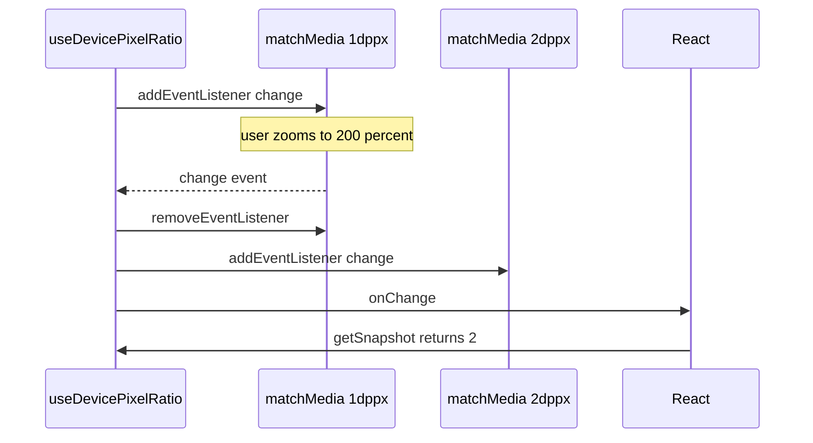

<!-- Generated by scripts/generate-docs.ts from src/catalog. Do not edit by hand. -->

# useDevicePixelRatio

> Live `devicePixelRatio` using the `(resolution: Xdppx)` media-query re-subscription trick.

🟡 intermediate · React 18.0+ · Custom Hooks › Device & preferences · support: universal

**Playground:** `npm run dev` → [`#/entry/use-device-pixel-ratio`](http://localhost:5173/#/entry/use-device-pixel-ratio)

## Concept

Subscribes to `matchMedia("(resolution: <current>dppx)")`. When that query stops matching, the ratio changed: the hook moves its listener to a query for the new ratio and notifies React.

## Problem

There is no `devicepixelratiochange` event, so canvases and image pickers silently go blurry after browser zoom or after moving the window to another monitor.

## When to use

- Sizing a `<canvas>` backing store (`width = cssWidth * dpr`).
- Choosing image or tile density in JavaScript (maps, charts, WebGL).

## When not to use

- Responsive images in markup — `srcset`/`<picture>` already pick the right density without JavaScript.

## API

```ts
function useDevicePixelRatio(options?: { defaultValue?: number }): number;
```

| Parameter                           | Type     | Description                                                                  |
| ----------------------------------- | -------- | ---------------------------------------------------------------------------- |
| `options.defaultValue` _(optional)_ | `number` | Server/hydration value and fallback when the browser reports 0. Default `1`. |

**Returns:** The current ratio, e.g. `1`, `1.25`, `2`.

## Implementation

- [`src/hooks/device/useDevicePixelRatio.ts`](../../src/hooks/device/useDevicePixelRatio.ts)

## Interactive example

- [`src/examples/custom-hooks/device/UseDevicePixelRatioDemo.tsx`](../../src/examples/custom-hooks/device/UseDevicePixelRatioDemo.tsx)

## Execution flow

1. Subscribe: create the query for the current ratio and listen for `change`.
2. Change: remove that listener, listen on a query for the new ratio, then call React’s `onChange`.
3. Snapshot: `window.devicePixelRatio` (a number, compared with `Object.is`).
4. Unsubscribe: removes whichever listener is current.

## Diagram: Re-subscribing on every ratio change

Each change moves the listener to a query for the new ratio.



## Edge cases

- Fractional ratios (1.25, 1.5 on Windows) produce queries like `(resolution: 1.25dppx)`, which work fine.
- Pinch-zoom on mobile does not change `devicePixelRatio`; browser zoom does.

## Browser support

Server and hydration render `defaultValue` (1). Without `matchMedia` it listens to `resize`.

## Testing

A custom `matchMedia` fake counts listeners per query to prove the listener moves from `1dppx` to `2dppx` and nothing remains after unmount; a separate test covers the `resize` fallback.

- [`src/hooks/device/useDevicePixelRatio.test.tsx`](../../src/hooks/device/useDevicePixelRatio.test.tsx)
- [`src/hooks/device/device.ssr.test.tsx`](../../src/hooks/device/device.ssr.test.tsx)
- [`src/examples/custom-hooks/device/DeviceDemos.test.tsx`](../../src/examples/custom-hooks/device/DeviceDemos.test.tsx)

## Related

- [useMediaQuery](use-media-query.md)
- [useOrientation](use-orientation.md)
- [useRef — canvas drawing](../built-in-hooks/use-ref-canvas.md)
- [MDN: devicePixelRatio (monitoring changes)](https://developer.mozilla.org/en-US/docs/Web/API/Window/devicePixelRatio) (official docs)
- [useSyncExternalStore](https://react.dev/reference/react/useSyncExternalStore) (official docs)
