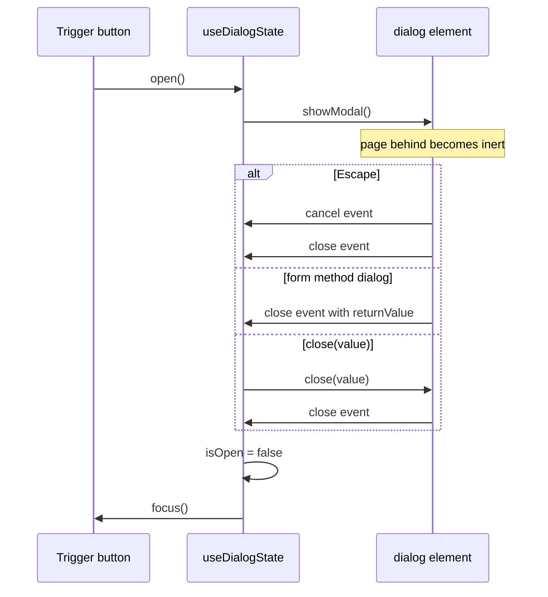

<!-- Generated by scripts/generate-docs.ts from src/catalog. Do not edit by hand. -->

# useDialogState

> Drive a native <dialog> as a modal: showModal/close, state synced with close/cancel events, focus restored to the trigger.

🟡 intermediate · React 18.0+ · Custom Hooks › Accessibility & interaction · support: client-only

**Playground:** `npm run dev` → [`#/entry/use-dialog-state`](http://localhost:5173/#/entry/use-dialog-state)

## Concept

Keeps the `<dialog>` mounted and returns `dialogProps` (`ref`, `aria-labelledby`, `onClose`, `onCancel`, `onClick`). `open()` remembers the focused trigger and calls `showModal()`; every way of closing — `close(value)`, Escape, `<form method="dialog">` — fires the element’s `close` event, which updates `isOpen`/`returnValue` and restores focus.

## Problem

Div-based modals must re-implement focus trapping, inertness of the page behind, Escape, stacking (`z-index`), a backdrop and focus restoration. Using `<dialog>` imperatively from React, on the other hand, easily lets `isOpen` drift from the element’s real state when the browser closes it.

## When to use

- Confirmations, forms in a modal, "are you sure?" prompts — any modal dialog.
- Reading which button closed the dialog through `returnValue`.

## When not to use

- Non-modal overlays (menus, tooltips, popovers) — use the Popover API or a disclosure.
- Information that does not require interrupting the user — show it inline.

## API

```ts
function useDialogState(options?: {
  defaultOpen?: boolean;
  onClose?: (returnValue: string) => void;
  closeOnEscape?: boolean;
  closeOnBackdropClick?: boolean;
  restoreFocus?: boolean;
}): {
  isOpen: boolean;
  open(): void;
  close(returnValue?: string): void;
  returnValue: string | undefined;
  dialogProps: DialogProps;
  titleId: string;
};
```

| Parameter                           | Type                    | Description                                                                         |
| ----------------------------------- | ----------------------- | ----------------------------------------------------------------------------------- |
| `onClose` _(optional)_              | `(returnValue) => void` | Runs after every close, e.g. act on `"delete"`.                                     |
| `closeOnEscape` _(optional)_        | `boolean`               | Default `true`; `false` prevents the `cancel` event.                                |
| `closeOnBackdropClick` _(optional)_ | `boolean`               | Default `false`. Clicks inside the dialog’s box (including padding) never close it. |
| `restoreFocus` _(optional)_         | `boolean`               | Default `true`.                                                                     |

**Returns:** `isOpen`, `open`, `close`, `returnValue`, `titleId` (put it on the heading) and `dialogProps`.

## Implementation

- [`src/hooks/accessibility/useDialogState.ts`](../../src/hooks/accessibility/useDialogState.ts)

## Interactive example

- [`src/examples/custom-hooks/accessibility/UseDialogStateDemo.tsx`](../../src/examples/custom-hooks/accessibility/UseDialogStateDemo.tsx)

## Execution flow

1. `open()`: store `document.activeElement`, call `showModal()` (browser moves focus inside, makes the page inert), set `isOpen`.
2. Escape → `cancel` (prevented if `closeOnEscape` is false) → `close`; `<form method="dialog">` → `close` with the button’s value.
3. `close` event: set `isOpen=false` and `returnValue`, focus the stored trigger if focus was lost, call `onClose`.
4. Unmount while open: the effect cleanup restores focus to the trigger.

## Diagram: Ways a native dialog closes

All paths converge on the close event, which keeps React in sync.



## Common mistakes

### Rendering the dialog conditionally with the open attribute

❌ Incorrect:

```tsx
{
  isOpen && <dialog open>…</dialog>;
}
```

The `open` attribute shows a _non-modal_ dialog: no inert page, no Escape, no backdrop, no top layer. Call `showModal()`.

### State that ignores browser-initiated closes

❌ Incorrect:

```tsx
const [open, setOpen] = useState(false);
useEffect(() => {
  open ? ref.current.showModal() : ref.current.close();
}, [open]);
```

Pressing Escape closes the element but `open` stays `true`, so the next "open" does nothing. Sync from the `close` event.

## Edge cases

- Chrome lets a second Escape close the dialog even if `cancel` is prevented (anti-abuse); do not rely on blocking Escape.
- Initial focus goes to the first focusable element (or one with the `autofocus` attribute) — put the safe action first.
- Newer browsers support `closedby="any"` for light dismiss natively.

## Browser support

`showModal()` is supported by all evergreen browsers; without it the dialog opens non-modally via the `open` attribute.

## Testing

jsdom lacks `showModal`, so tests install a small polyfill (`test/installDialogPolyfill.ts`) that models open/close, Escape → `cancel` and `<form method="dialog">` — but deliberately not focus restoration, so the tests prove the hook restores focus. Covered: labelling, initial focus, `returnValue`, Escape (allowed and prevented), backdrop vs padding clicks, `defaultOpen`, unmount while open and the no-`showModal` fallback; the demo test runs axe-core on the open dialog.

- [`src/hooks/accessibility/useDialogState.test.tsx`](../../src/hooks/accessibility/useDialogState.test.tsx)
- [`src/hooks/accessibility/accessibility.ssr.test.tsx`](../../src/hooks/accessibility/accessibility.ssr.test.tsx)
- [`src/examples/custom-hooks/accessibility/UseDialogStateDemo.test.tsx`](../../src/examples/custom-hooks/accessibility/UseDialogStateDemo.test.tsx)

## Production considerations

- Style `::backdrop` and respect `prefers-reduced-motion` for open animations (the demo does both).
- Lock background scrolling if your layout needs it; `showModal()` does not do that.

## Related

- [useFocusTrap](use-focus-trap.md)
- [useEscapeKey](use-escape-key.md)
- [useDisclosure](use-disclosure.md)
- [useScrollLock](use-scroll-lock.md)
- [MDN: <dialog>](https://developer.mozilla.org/en-US/docs/Web/HTML/Reference/Elements/dialog) (official docs)
- [MDN: HTMLDialogElement.showModal()](https://developer.mozilla.org/en-US/docs/Web/API/HTMLDialogElement/showModal) (official docs)
- [WAI-ARIA APG: Dialog (modal) pattern](https://www.w3.org/WAI/ARIA/apg/patterns/dialog-modal/) (official docs)
