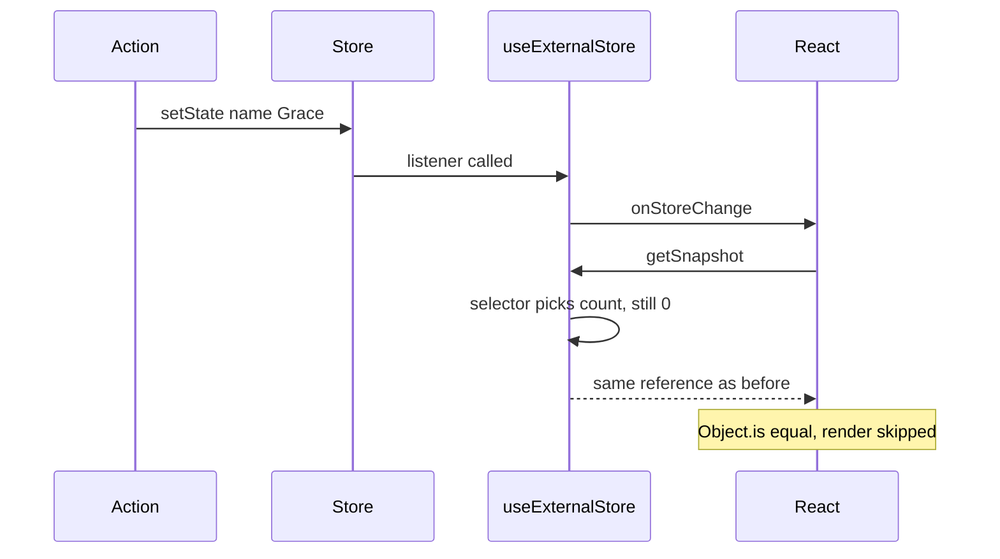

<!-- Generated by scripts/generate-docs.ts from src/catalog. Do not edit by hand. -->

# useExternalStore

> A teaching version of Zustand’s core: `createStore()` + a selector hook that skips renders when the selected slice is unchanged.

🔴 advanced · React 18.0+ · Custom Hooks › Advanced patterns · support: universal

**Playground:** `npm run dev` → [`#/entry/use-external-store`](http://localhost:5173/#/entry/use-external-store)

## Concept

`createStore(initial | (set, get) => state)` keeps state outside React with `getState`, `setState(patch | updater, replace?)` and `subscribe`. `useExternalStore(store, selector, equalityFn)` subscribes a component to `selector(state)` only.

## Problem

A single context value re-renders every consumer on any change. Selector subscriptions let each component re-render only when _its_ slice changes, without memo gymnastics.

## When to use

- App-wide client state read by many components that each need a small slice.
- State that must be read/written outside React (WebSocket handlers, tests, devtools).
- Learning how Zustand, Redux’s `useSelector` and similar libraries work.

## When not to use

- Production apps with middleware, devtools, persistence or SSR hydration needs — use Zustand, Redux Toolkit or Jotai.
- Server data — use TanStack Query or SWR.
- State used by one component — `useState`/`useReducer` is simpler.

## API

```ts
function useExternalStore<T extends object, U = T>(
  store: ExternalStore<T>,
  selector?: (state: T) => U,
  equalityFn?: (previous: U, next: U) => boolean,
): U;
```

| Parameter                 | Type                                | Description                                                                             |
| ------------------------- | ----------------------------------- | --------------------------------------------------------------------------------------- |
| `store`                   | `ExternalStore<T>`                  | From `createStore`. Stable.                                                             |
| `selector` _(optional)_   | `(state: T) => U`                   | Picks the slice. Default: the whole state. Inline selectors are fine.                   |
| `equalityFn` _(optional)_ | `(previous: U, next: U) => boolean` | Default `Object.is`. Use `shallowEqualObjects` for selectors that build objects/arrays. |

**Returns:** The selected slice.

## Implementation

- [`src/hooks/advanced/useExternalStore.ts`](../../src/hooks/advanced/useExternalStore.ts)
- [`src/hooks/advanced/createStore.ts`](../../src/hooks/advanced/createStore.ts)

## Interactive example

- [`src/examples/custom-hooks/advanced/UseExternalStoreDemo.tsx`](../../src/examples/custom-hooks/advanced/UseExternalStoreDemo.tsx)

## Execution flow

1. `setState` merges the patch into a _new_ state object and calls every listener synchronously (`Object.is`-equal results are skipped).
2. `getSnapshot` memoises `(state, selection)`: same state → same selection; new state but `equalityFn` equal → the previous reference.
3. `useSyncExternalStore` compares that reference with `Object.is`; unchanged → no render.
4. Unmount: the store listener is removed.

## Diagram: Why unrelated updates do not re-render

The selector result is compared before React schedules a render.



## Common mistakes

### Selecting a new object without an equality function

❌ Incorrect:

```tsx
const { a, b } = useExternalStore(store, (s) => ({ a: s.a, b: s.b }));
```

The selector returns a new object for every state change, so the component re-renders even when `a` and `b` did not change.

✅ Correct:

```tsx
const { a, b } = useExternalStore(store, (s) => ({ a: s.a, b: s.b }), shallowEqualObjects);
```

### Mutating state in place

❌ Incorrect:

```tsx
store.getState().todos.push(todo);
```

The state reference does not change, so no listener runs and selectors keep returning the cached value.

✅ Correct:

```tsx
store.setState((s) => ({ todos: [...s.todos, todo] }));
```

## Edge cases

- Listeners added during a `setState` run start on the next update (the listener set is copied).
- `setState(next, true)` replaces the state instead of merging.

## Browser support

The server renders the store’s current state; create stores per request if they hold user data.

## Testing

A render-count test wraps two components in `<Profiler>` and proves that updating one slice commits only its subscriber; other tests cover equality functions, initializer actions and unsubscribe on unmount.

- [`src/hooks/advanced/useExternalStore.test.tsx`](../../src/hooks/advanced/useExternalStore.test.tsx)
- [`src/hooks/advanced/advanced.ssr.test.tsx`](../../src/hooks/advanced/advanced.ssr.test.tsx)
- [`src/examples/custom-hooks/advanced/AdvancedDemos.test.tsx`](../../src/examples/custom-hooks/advanced/AdvancedDemos.test.tsx)

## Production considerations

- Define selectors at module level when they are reused; keep store modules free of React imports.

## Related

- [Zustand](../state-management/zustand.md)
- [useSyncExternalStore — shared external store](../built-in-hooks/use-sync-external-store.md)
- [useContext — avoiding unnecessary re-renders](../built-in-hooks/use-context-performance.md)
- [useSubscription](use-subscription.md)
- [useSyncExternalStore](https://react.dev/reference/react/useSyncExternalStore) (official docs)
- [Zustand: vanilla createStore](https://zustand.docs.pmnd.rs/reference/apis/create-store) (official docs)
