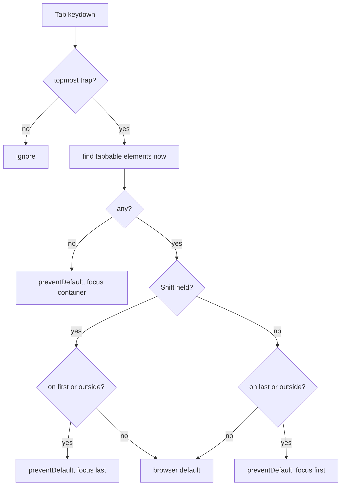

<!-- Generated by scripts/generate-docs.ts from src/catalog. Do not edit by hand. -->

# useFocusTrap

> Keep Tab/Shift+Tab inside a container, set initial focus and restore focus afterwards — for overlays that cannot be a native <dialog>.

🔴 advanced · React 16.8+ · Custom Hooks › Accessibility & interaction · support: client-only

**Playground:** `npm run dev` → [`#/entry/use-focus-trap`](http://localhost:5173/#/entry/use-focus-trap)

## Concept

While active, a document `keydown` listener wraps Tab from the last tabbable element to the first (and Shift+Tab the other way), and a `focusin` listener pulls focus back if it escapes. Tabbable elements (exported as `getTabbableElements`) are recomputed on every key press. On deactivation, focus returns to the element that was focused before.

## Problem

A custom modal overlay built from `<div>`s lets Tab wander into the page behind it, leaves focus on `<body>` when it closes, and breaks as soon as its content changes.

## When to use

- Custom overlays that cannot use `<dialog>`: legacy design-system modals, full-screen mobile menus, lightboxes rendered by third-party code.
- Nested overlays — only the most recently activated trap reacts.

## When not to use

- **Modal dialogs: prefer a native `<dialog>` opened with `showModal()`** (see `useDialogState`). The browser makes everything else inert, handles Escape, the backdrop and top-layer stacking — no JavaScript trap needed.
- Non-modal content (menus, popovers, inline editors) — trapping focus there is an accessibility bug; users must be able to Tab away. Use the Popover API or close on focus-out instead.
- A battle-tested alternative: the `focus-trap` package or React Aria’s `FocusScope`.

## API

```ts
function useFocusTrap(
  containerRef: RefObject<HTMLElement | null>,
  options?: {
    active?: boolean;
    initialFocus?: 'first' | 'container' | RefObject<HTMLElement | null> | false;
    restoreFocus?: boolean;
    returnFocusTo?: RefObject<HTMLElement | null>;
  },
): void;
```

| Parameter                            | Type                                     | Description                                                                            |
| ------------------------------------ | ---------------------------------------- | -------------------------------------------------------------------------------------- |
| `containerRef`                       | `RefObject<HTMLElement \| null>`         | The element focus is kept inside.                                                      |
| `options.active` _(optional)_        | `boolean`                                | Default `true`.                                                                        |
| `options.initialFocus` _(optional)_  | `'first' \| 'container' \| ref \| false` | Default `first` (falls back to the container, which gets `tabindex="-1"` temporarily). |
| `options.restoreFocus` _(optional)_  | `boolean`                                | Default `true`.                                                                        |
| `options.returnFocusTo` _(optional)_ | `RefObject`                              | Focus this instead of the previously focused element.                                  |

**Returns:** Nothing.

## Implementation

- [`src/hooks/accessibility/useFocusTrap.ts`](../../src/hooks/accessibility/useFocusTrap.ts)
- [`src/hooks/accessibility/tabbable.ts`](../../src/hooks/accessibility/tabbable.ts)
- [`src/hooks/accessibility/layerStack.ts`](../../src/hooks/accessibility/layerStack.ts)

## Interactive example

- [`src/examples/custom-hooks/accessibility/UseFocusTrapDemo.tsx`](../../src/examples/custom-hooks/accessibility/UseFocusTrapDemo.tsx)

## Execution flow

1. Effect (active): remember `document.activeElement`, push a layer, move focus inside unless it already is.
2. Tab keydown (topmost layer only): find tabbables; at an edge (or with focus outside) `preventDefault()` and focus the other end; with no tabbables focus the container.
3. Focusin outside the container: refocus the last focused element inside, or the first tabbable.
4. Cleanup: remove listeners and the layer, drop the temporary tabindex, and restore focus if it is on `<body>` or still inside the container.

## Diagram: Tab handling while the trap is active

Decisions made on every Tab key press.



## Common mistakes

### Caching the tabbable list

❌ Incorrect:

```tsx
const [first, last] = edges(container); // computed once on open
```

Content added, removed or disabled while open (validation messages, "add item") breaks the cycle. Look elements up on each key press.

### Forgetting focus restoration

❌ Incorrect:

```tsx
{
  open && <Overlay />;
} // focus falls to <body> on close
```

Keyboard and screen-reader users lose their place and must start from the top of the page.

## Edge cases

- Radio groups count once (the checked radio, or the first); disabled controls, `tabindex="-1"`, `hidden` and `inert` subtrees are skipped.
- Positive `tabindex` values are treated like `0` — avoid them.
- Overlays rendered outside the container (portals to `<body>`) pull focus out; render nested overlays inside, or give them their own trap.
- Parent and child traps activated in the same commit register child-first; activate nested layers on user interaction.

## Browser support

Uses `Element.checkVisibility()` when available to skip hidden elements; falls back to `hidden`/`inert` attribute checks.

## Testing

User-event tests Tab and Shift+Tab around the edges, skip disabled buttons, include content added while active, pull escaped focus back, focus an empty container, honour `initialFocus`/`restoreFocus` options, restore focus on deactivation and let only the innermost of two nested traps act. The demo test also runs axe-core on the open drawer.

- [`src/hooks/accessibility/useFocusTrap.test.tsx`](../../src/hooks/accessibility/useFocusTrap.test.tsx)
- [`src/hooks/accessibility/accessibility.ssr.test.tsx`](../../src/hooks/accessibility/accessibility.ssr.test.tsx)
- [`src/examples/custom-hooks/accessibility/UseFocusTrapDemo.test.tsx`](../../src/examples/custom-hooks/accessibility/UseFocusTrapDemo.test.tsx)

## Related

- [useDialogState](use-dialog-state.md)
- [useEscapeKey](use-escape-key.md)
- [useScrollLock](use-scroll-lock.md)
- [useClickOutside](use-click-outside.md)
- [WAI-ARIA APG: Dialog (modal) pattern](https://www.w3.org/WAI/ARIA/apg/patterns/dialog-modal/) (official docs)
- [MDN: <dialog>](https://developer.mozilla.org/en-US/docs/Web/HTML/Reference/Elements/dialog) (official docs)
- [MDN: inert](https://developer.mozilla.org/en-US/docs/Web/HTML/Reference/Global_attributes/inert) (official docs)
