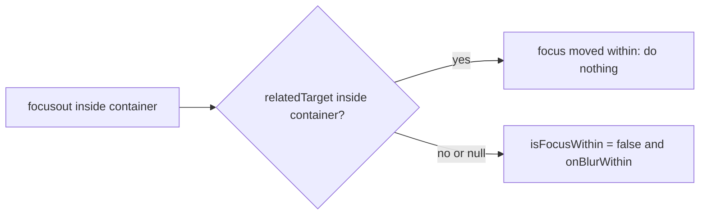

<!-- Generated by scripts/generate-docs.ts from src/catalog. Do not edit by hand. -->

# useFocusWithin

> Focus state for a whole subtree, with enter/leave callbacks that use `relatedTarget` so moving inside does not count.

🟡 intermediate · React 16.8+ · Custom Hooks › Browser & DOM · support: client-only

**Playground:** `npm run dev` → [`#/entry/use-focus-within`](http://localhost:5173/#/entry/use-focus-within)

## Concept

Listens to bubbling `focusin`/`focusout` on a container. On `focusout`, `relatedTarget` (the element about to receive focus) decides: still inside → nothing happens; outside or `null` → `onBlurWithin` fires and the state turns `false`.

## Problem

A plain `onBlur` on a group fires every time focus moves between its own fields, so "close the popover when focus leaves" or "validate the address when the user is done with it" fire far too early.

## When to use

- Closing non-modal popovers, menus and comboboxes when keyboard focus leaves them.
- Validating or saving a group of fields once the user leaves the group.

## When not to use

- Styling the group — CSS `:focus-within` does it without JavaScript.
- Modal dialogs, which should trap focus instead of reacting to it leaving.

## API

```ts
function useFocusWithin<T extends HTMLElement | SVGElement = HTMLElement>(options?: {
  onFocusWithin?: (event: FocusEvent) => void;
  onBlurWithin?: (event: FocusEvent) => void;
}): readonly [ref: (node: T | null) => void, isFocusWithin: boolean];
```

| Parameter                            | Type                          | Description                                                            |
| ------------------------------------ | ----------------------------- | ---------------------------------------------------------------------- |
| `options.onFocusWithin` _(optional)_ | `(event: FocusEvent) => void` | Focus entered from outside.                                            |
| `options.onBlurWithin` _(optional)_  | `(event: FocusEvent) => void` | Focus left the subtree (including to nothing, or the window blurring). |

**Returns:** A stable callback ref and `isFocusWithin`.

## Implementation

- [`src/hooks/browser/useFocusWithin.ts`](../../src/hooks/browser/useFocusWithin.ts)

## Interactive example

- [`src/examples/custom-hooks/browser/UseFocusDemo.tsx`](../../src/examples/custom-hooks/browser/UseFocusDemo.tsx)

## Diagram: focusout decision

How `relatedTarget` separates moving inside from leaving.



## Common mistakes

### Using blur for a group

❌ Incorrect:

```tsx
<fieldset onBlur={() => validate()}>
```

React’s `onBlur` bubbles (it is `focusout`): it fires when tabbing from Street to City, inside the same group.

✅ Correct:

```tsx
<fieldset onBlur={(e) => { if (!e.currentTarget.contains(e.relatedTarget)) validate(); }}>
```

## Edge cases

- Clicking a non-focusable area inside the group moves focus to `body` (`relatedTarget` is `null`) and counts as leaving.
- Switching windows/tabs fires `focusout` with `relatedTarget: null`; returning fires `focusin` again.
- Some browsers fire no `focusout` when the focused element is removed from the DOM; the state then stays `true` until focus changes again.

## Browser support

`false` on the server.

## Testing

Tests tab into, within and out of a fieldset and assert exactly one enter and one leave callback, the `relatedTarget` passed out, the `null` relatedTarget case and listener removal.

- [`src/hooks/browser/useFocusWithin.test.tsx`](../../src/hooks/browser/useFocusWithin.test.tsx)
- [`src/examples/custom-hooks/browser/UseFocusDemo.test.tsx`](../../src/examples/custom-hooks/browser/UseFocusDemo.test.tsx)

## Related

- [useFocus](use-focus.md)
- [useClickOutside](use-click-outside.md)
- [MDN: focusout event](https://developer.mozilla.org/en-US/docs/Web/API/Element/focusout_event) (official docs)
- [MDN: FocusEvent.relatedTarget](https://developer.mozilla.org/en-US/docs/Web/API/FocusEvent/relatedTarget) (official docs)
- [MDN: :focus-within](https://developer.mozilla.org/en-US/docs/Web/CSS/Reference/Selectors/:focus-within) (official docs)
