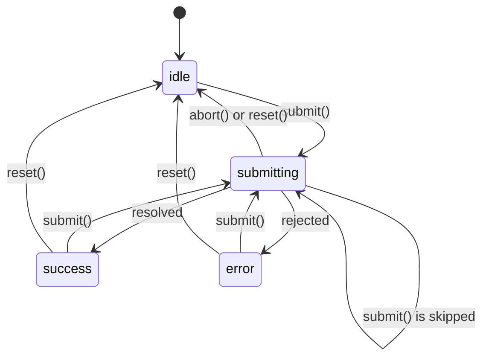

<!-- Generated by scripts/generate-docs.ts from src/catalog. Do not edit by hand. -->

# useFormSubmission

> Async submit lifecycle: idle → submitting → success/error, no double submits, abort on unmount.

🟡 intermediate · React 16.8+ · Custom Hooks › Forms & input · support: universal

**Playground:** `npm run dev` → [`#/entry/use-form-submission`](http://localhost:5173/#/entry/use-form-submission)

## Concept

`useFormSubmission(submitFn, { onSuccess, onError })` returns `status`, `isSubmitting`, `data`, `error`, `submit(args)`, `abort()` and `reset()`. `submitFn` receives an `AbortSignal`; `submit` never rejects and resolves with an outcome (`success`, `error`, `skipped`, `aborted`).

## Problem

Disabling the button via state is too late for a fast double click (both clicks run before React re-renders), and responses arriving after the form unmounted trigger callbacks — navigation, toasts — for a form that no longer exists.

## When to use

- Client-side form submissions that call an API and show pending/success/error UI.
- Any "one at a time" async action (save, publish, pay) that needs cancellation.

## When not to use

- Simple submit-and-show-result forms in React 19: `<form action={fn}>` with `useActionState` (result + pending state) and `useFormStatus` (pending state in a child button) need no custom hook, work with uncontrolled inputs and progressively enhance with Server Functions.
- Server-state mutations that should update cached queries — TanStack Query’s `useMutation` adds retries, cache invalidation and optimistic updates.
- Generic async functions that are not submissions (`useAsyncFn` in the async category covers those).

## API

```ts
function useFormSubmission<A = void, R = unknown>(
  submitFn: (args: A, signal: AbortSignal) => Promise<R>,
  options?: { onSuccess?: (data: R) => void; onError?: (error: Error) => void },
): UseFormSubmissionResult<A, R>;
```

| Parameter                                  | Type                           | Description                                       |
| ------------------------------------------ | ------------------------------ | ------------------------------------------------- |
| `submitFn`                                 | `(args, signal) => Promise<R>` | May change between renders; the latest is called. |
| `options.onSuccess / onError` _(optional)_ | `callbacks`                    | Not called for aborted submissions.               |

**Returns:** `status`, `isSubmitting`, `data`, `error`, `submit(args) → Promise<SubmissionOutcome>`, `abort()`, `reset()` (the functions are stable).

## Implementation

- [`src/hooks/forms/useFormSubmission.ts`](../../src/hooks/forms/useFormSubmission.ts)

## Interactive example

- [`src/examples/custom-hooks/forms/UseFormSubmissionDemo.tsx`](../../src/examples/custom-hooks/forms/UseFormSubmissionDemo.tsx)

## Execution flow

1. `submit`: if a ref holds an in-flight controller, resolve `{ status: "skipped" }` immediately.
2. Otherwise create an `AbortController`, set `submitting`, await `submitFn(args, signal)`.
3. On settle: if our signal was aborted → `aborted` (state untouched); else set `success`/`error` and call the callback.
4. Unmount: aborts the in-flight controller.

## Diagram: Submission lifecycle

States and transitions handled by the hook.



## Common mistakes

### Guarding with state only

❌ Incorrect:

```tsx
if (isSubmitting) return;
setIsSubmitting(true);
await save();
```

Two clicks in the same frame both read `isSubmitting === false`. A ref is updated synchronously.

### Ignoring unmount

❌ Incorrect:

```tsx
await save();
navigate('/done');
```

If the user left the page meanwhile, this navigates them away from wherever they are now. Abort on unmount and skip follow-up work.

## Edge cases

- An `AbortError` that did not come from our signal (e.g. an inner timeout) is treated as a failure.
- `abort()` returns the status to `idle`; `reset()` also clears `data` and `error`.

## Testing

Deferred promises step through `submitting → success`; two synchronous `submit()` calls prove only one request starts; abort and unmount tests check that the signal is aborted and callbacks are not called. The demo test uses MSW overrides for fast responses and the default slow endpoint for cancellation.

- [`src/hooks/forms/useFormSubmission.test.tsx`](../../src/hooks/forms/useFormSubmission.test.tsx)
- [`src/examples/custom-hooks/forms/UseFormSubmissionDemo.test.tsx`](../../src/examples/custom-hooks/forms/UseFormSubmissionDemo.test.tsx)

## Related

- [useForm](use-form.md)
- [useAsyncFn](use-async-fn.md)
- [useLatest](use-latest.md)
- [useActionState](https://react.dev/reference/react/useActionState) (official docs)
- [useFormStatus](https://react.dev/reference/react-dom/hooks/useFormStatus) (official docs)
- [TanStack Query: mutations](https://tanstack.com/query/latest/docs/framework/react/guides/mutations) (official docs)
