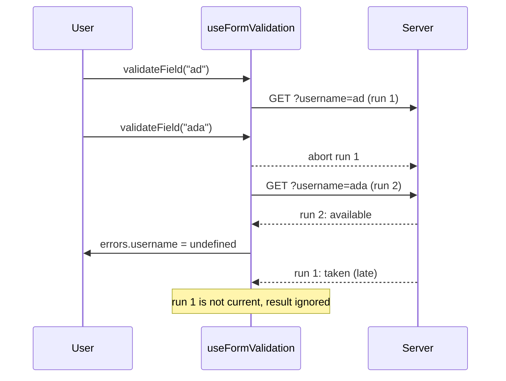

<!-- Generated by scripts/generate-docs.ts from src/catalog. Do not edit by hand. -->

# useFormValidation

> Headless sync + async validation per field with cancellation of stale async checks.

🔴 advanced · React 16.8+ · Custom Hooks › Forms & input · support: universal

**Playground:** `npm run dev` → [`#/entry/use-form-validation`](http://localhost:5173/#/entry/use-form-validation)

## Concept

Given rules `{ [field]: { validate, validateAsync, asyncDebounceMs } }`, returns an `errors` map, a `validating` map and `validateField(name, values)` / `validateAll(values)`. It stores no values, so it composes with any state (it powers `useField` and `useForm`). Pure helpers `runSyncValidators` and `validateSync` are exported too.

## Problem

Async checks ("is this username free?") race: typing "ad" then "ada" sends two requests, and if the first answers last its stale "taken" overwrites the correct "available". Hand-written versions also forget to cancel requests and to skip the network when a sync rule already fails.

## When to use

- Server-backed rules: unique username/email, coupon codes, address lookup.
- Building your own form abstraction on top of a headless validator.

## When not to use

- Schema validation of a whole object — use Zod/Valibot with React Hook Form or TanStack Form resolvers.
- Uniqueness that only matters at submit — validate on the server when submitting and map the error to the field (the sign-up demo does this for "racer").

## API

```ts
function useFormValidation<V extends object>(rules: {
  [K in keyof V]?: {
    validate?: SyncValidator | SyncValidator[];
    validateAsync?: (value, values, signal) => Promise<string | undefined>;
    asyncDebounceMs?: number;
  };
}): UseFormValidationResult<V>;
```

| Parameter | Type                 | Description                                                |
| --------- | -------------------- | ---------------------------------------------------------- |
| `rules`   | `ValidationRules<V>` | May be an inline object; the latest rules are always used. |

**Returns:** `errors`, `validating`, `isValidating`, `validateField(name, values, { immediate?, skipAsync? })`, `validateAll(values)`, `setFieldError(name, message)` and `clearErrors(names?)`.

## Implementation

- [`src/hooks/forms/useFormValidation.ts`](../../src/hooks/forms/useFormValidation.ts)
- [`src/mocks/extra/forms.ts`](../../src/mocks/extra/forms.ts)

## Interactive example

- [`src/examples/custom-hooks/forms/UseFormValidationDemo.tsx`](../../src/examples/custom-hooks/forms/UseFormValidationDemo.tsx)

## Execution flow

1. `validateField` aborts the field’s previous controller, records a new run, and runs sync validators — a failure stops here (no request).
2. Otherwise it marks the field validating, waits `asyncDebounceMs` (abortable), then calls `validateAsync(value, values, signal)`.
3. When the promise settles, the result is applied only if this run is still the latest; a superseded call resolves with the newer run’s result.
4. Unmount aborts every pending run; results that arrive later are ignored.

## Diagram: Stale async validation is ignored

Typing "ad" then "ada": the first request is aborted and its late answer discarded.



## Common mistakes

### Last response wins

❌ Incorrect:

```tsx
onChange={async (e) => {
  const taken = await isTaken(e.target.value);
  setError(taken ? "Taken" : undefined);
}}
```

Responses can arrive out of order, so an old answer overwrites the new one. Track the latest run and abort the rest.

✅ Correct:

```tsx
validation.validateField('username', { username: e.target.value });
```

### Swallowing async validator failures

❌ Incorrect:

```tsx
validateAsync: async (v) => {
  try {
    return await check(v);
  } catch {
    return undefined;
  }
};
```

A network error would be reported as "valid". The hook surfaces thrown errors as the field message instead.

## Edge cases

- Clearing errors (`clearErrors`) aborts that field’s pending check so a late result cannot reappear.
- `validateAll` runs async validators immediately (no debounce) and in parallel.
- A thrown non-abort error becomes the message, e.g. "Could not check availability (503)".

## Testing

Deferred promises reproduce the race: the slow stale result resolves last and is ignored, and its signal is aborted. Fake timers verify the debounce; other tests cover sync short-circuiting, thrown errors, `clearErrors` and abort on unmount. The demo test drives the real MSW endpoint, whose latency is inverted to provoke the race.

- [`src/hooks/forms/useFormValidation.test.tsx`](../../src/hooks/forms/useFormValidation.test.tsx)
- [`src/examples/custom-hooks/forms/UseFormValidationDemo.test.tsx`](../../src/examples/custom-hooks/forms/UseFormValidationDemo.test.tsx)

## Production considerations

- Always pass `signal` to `fetch` so superseded checks stop using bandwidth.
- Re-check uniqueness on the server at submit time — a client-side check is only a hint.

## Related

- [useField](use-field.md)
- [useForm](use-form.md)
- [useLatest](use-latest.md)
- [MDN: AbortController](https://developer.mozilla.org/en-US/docs/Web/API/AbortController) (official docs)
- [Fetching data: race conditions](https://react.dev/reference/react/useEffect#fetching-data-with-effects) (official docs)
