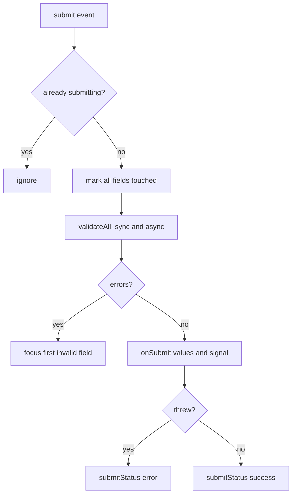

<!-- Generated by scripts/generate-docs.ts from src/catalog. Do not edit by hand. -->

# useForm

> A small form controller: `register()`, sync + async validation, dirty state, async submit and focus on the first invalid field.

🔴 advanced · React 19.0+ · Custom Hooks › Forms & input · support: universal

**Playground:** `npm run dev` → [`#/entry/use-form`](http://localhost:5173/#/entry/use-form)

## Concept

Holds all values and touched state, binds native controls with `register(name)` (text-like inputs, `<select>`, `<textarea>`, checkboxes), and composes `useFormValidation`, `useFormDirtyState` and `useFormSubmission`. `handleSubmit(onSubmit)` validates everything (including async rules), moves focus to the first invalid field in DOM order, or runs `onSubmit(values, signal)`.

## Problem

Forms combine many concerns — values, per-field timing of errors, cross-field rules, async checks, dirty tracking, pending/error states, double-submit protection and accessible error handling. Re-implementing them per form leads to inconsistent and inaccessible forms.

## When to use

- Small and medium forms (sign-up, settings, checkout steps) where a dependency-free, readable controller is preferred.
- Teaching or prototyping the mechanics that form libraries automate.

## When not to use

- Large or highly dynamic forms (dozens of fields, nested arrays, schema validation with Zod/Valibot, field-level re-render isolation): use [React Hook Form](https://react-hook-form.com/), [TanStack Form](https://tanstack.com/form/latest) or [Formik](https://formik.org/docs/overview). These hooks are small and readable on purpose.
- Simple submit-and-show-result forms in React 19: `<form action={fn}>` with `useActionState` (result + pending state) and `useFormStatus` (pending state in a child button) need no custom hook, work with uncontrolled inputs and progressively enhance with Server Functions.
- Very large forms where re-rendering on every keystroke is measurable — React Hook Form keeps inputs uncontrolled and isolates re-renders per field.

## API

```ts
function useForm<V extends object>(options: {
  initialValues: V;
  rules?: FormRules<V>;
  mode?: 'onBlur' | 'onChange' | 'onTouched';
  warnOnUnsavedChanges?: boolean;
  focusFirstInvalid?: boolean;
  id?: string;
}): UseFormResult<V>;
```

| Parameter                           | Type                                    | Description                                                                                                        |
| ----------------------------------- | --------------------------------------- | ------------------------------------------------------------------------------------------------------------------ |
| `initialValues`                     | `V`                                     | Captured on mount; use `reset(next)` to adopt saved values as the new baseline.                                    |
| `rules` _(optional)_                | `FormRules<V>`                          | Per-field `validate`, `validateAsync`, `asyncDebounceMs` and `deps` (fields to re-validate when this one changes). |
| `mode` _(optional)_                 | `'onBlur' \| 'onChange' \| 'onTouched'` | When fields validate before submit. Default `onTouched`.                                                           |
| `warnOnUnsavedChanges` _(optional)_ | `boolean`                               | `beforeunload` guard while dirty.                                                                                  |
| `focusFirstInvalid` _(optional)_    | `boolean`                               | Default `true`.                                                                                                    |

**Returns:** `values`, `errors`, `touched`, `validating`, `isValid`, `isDirty`, `dirtyFields`, `isSubmitting`, `submitStatus`, `submitError`, `submitCount`, `register`, `getFieldIds`, `setValue`, `setFieldError`, `focusField`, `validateFields`, `handleSubmit`, `abortSubmit`, `reset`.

## Implementation

- [`src/hooks/forms/useForm.ts`](../../src/hooks/forms/useForm.ts)
- [`src/hooks/forms/useFormValidation.ts`](../../src/hooks/forms/useFormValidation.ts)
- [`src/hooks/forms/useFormDirtyState.ts`](../../src/hooks/forms/useFormDirtyState.ts)
- [`src/hooks/forms/useFormSubmission.ts`](../../src/hooks/forms/useFormSubmission.ts)
- [`src/examples/custom-hooks/forms/FormRow.tsx`](../../src/examples/custom-hooks/forms/FormRow.tsx)
- [`src/mocks/extra/forms.ts`](../../src/mocks/extra/forms.ts)

## Interactive example

- [`src/examples/custom-hooks/forms/UseFormDemo.tsx`](../../src/examples/custom-hooks/forms/UseFormDemo.tsx)

## Execution flow

1. Render: `register(name)` returns `id`, `name`, `value`/`checked`, handlers, a ref callback and `aria-invalid`/`aria-describedby` (→ `${id}-error`).
2. Change: values are written to a ref and state; the field (and its `deps`) re-validate according to `mode` and touched state.
3. Submit: prevent default → ignore if already submitting → mark all touched → `validateAll` → focus first invalid element (sorted with `compareDocumentPosition`) or `submit({ values, onSubmit })`.
4. Unmount: pending validations and the submission are aborted by the composed hooks.

## Diagram: handleSubmit

What happens when the user submits.



## Common mistakes

### Disabling the submit button until the form is valid

❌ Incorrect:

```tsx
<button disabled={!form.isValid}>Sign up</button>
```

Users cannot discover what is wrong, and disabled buttons are skipped by keyboard and often unexplained to screen readers. Let them submit; show errors and move focus to the first invalid field.

✅ Correct:

```tsx
<button type="submit">Sign up</button> // handleSubmit focuses the first invalid field
```

### Losing server-side field errors

❌ Incorrect:

```tsx
catch (e) { setBanner(e.message) }
```

A 409 "username taken" belongs on the username field. Use `setFieldError` + `focusField` so it is announced in context.

## Edge cases

- Inputs are not locked while submitting; the submitted values are the snapshot taken when submit started.
- Rules with only async validators count as valid in `isValid` until they have run.
- Fields that are not rendered (e.g. other wizard steps) cannot receive focus — validate per step (`validateFields`).

## Testing

Integration tests render a sign-up form: validation timing (`onTouched`), `deps` re-validation, focus on the first invalid field after submit, async validation on submit, success/error submit states, the double-submit guard and reset. The demo test hits the MSW sign-up endpoint (including a 409 mapped to the field) and runs axe-core.

- [`src/hooks/forms/useForm.test.tsx`](../../src/hooks/forms/useForm.test.tsx)
- [`src/hooks/forms/forms.ssr.test.tsx`](../../src/hooks/forms/forms.ssr.test.tsx)
- [`src/examples/custom-hooks/forms/UseFormDemo.test.tsx`](../../src/examples/custom-hooks/forms/UseFormDemo.test.tsx)

## Production considerations

- Keep `noValidate` on the `<form>` when you render your own messages, but still set `required`/`type` for semantics and autofill.
- Re-validate on the server; client validation is a UX aid, not security.

## Related

- [useFormValidation](use-form-validation.md)
- [useFormDirtyState](use-form-dirty-state.md)
- [useFormSubmission](use-form-submission.md)
- [useFieldArray](use-field-array.md)
- [useMultiStepForm](use-multi-step-form.md)
- [useField](use-field.md)
- [React Hook Form: useForm](https://react-hook-form.com/docs/useform) (official docs)
- [useActionState](https://react.dev/reference/react/useActionState) (official docs)
- [<form> in React](https://react.dev/reference/react-dom/components/form) (official docs)
- [W3C WAI: User notifications in forms](https://www.w3.org/WAI/tutorials/forms/notifications/) (official docs)
