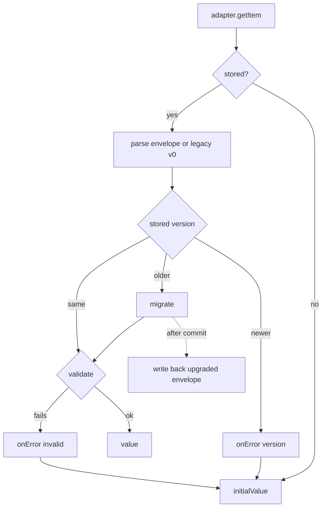

<!-- Generated by scripts/generate-docs.ts from src/catalog. Do not edit by hand. -->

# usePersistentState

> Persistent state with a pluggable storage adapter and versioned schema migrations.

🔴 advanced · React 18.0+ · Custom Hooks › Storage & persistence · support: client-only

**Playground:** `npm run dev` → [`#/entry/use-persistent-state`](http://localhost:5173/#/entry/use-persistent-state)

## Concept

Stores `{"__v": version, "value": …}` through any synchronous `PersistenceAdapter`. On read, older data runs through `migrate(oldValue, oldVersion)` and is written back once; data from a newer version is ignored and reported.

## Problem

Persisted shapes evolve. Without versioning, a release that renames a field reads old data as garbage (or crashes), and a rollback misreads data written by the newer release.

## When to use

- Persisted settings or drafts whose shape will change across releases.
- Storage that is not Web Storage: an in-memory map (tests, SSR), a namespaced or encrypted wrapper, a native bridge.

## When not to use

- Simple preferences that will never change shape — `useLocalStorage` is simpler.
- Async backends (IndexedDB, remote APIs) — adapters are synchronous; use a data library.
- Secrets: storage is readable by any script on the origin, and “encryption” with a key shipped to the browser is obfuscation.

## API

```ts
function usePersistentState<T>(
  key: string,
  initialValue: T | (() => T),
  options: {
    adapter: PersistenceAdapter;
    version?: number;
    migrate?: (oldValue: unknown, oldVersion: number) => unknown;
    validate?: (value: unknown) => value is T;
    onError?: (error: PersistentStateError) => void;
  },
): readonly [value: T, setValue: SetStorageValue<T>, remove: () => void];
```

| Parameter                       | Type                                | Description                                                                                                                                                   |
| ------------------------------- | ----------------------------------- | ------------------------------------------------------------------------------------------------------------------------------------------------------------- |
| `options.adapter`               | `PersistenceAdapter`                | `{ getItem, setItem, removeItem, subscribe? }`. Use `webStorageAdapter("local" \| "session")` or `createMemoryAdapter()`; define custom ones at module level. |
| `options.version` _(optional)_  | `number`                            | Current schema version. Default `1`.                                                                                                                          |
| `options.migrate` _(optional)_  | `(oldValue, oldVersion) => unknown` | Upgrades older data. Non-enveloped legacy data arrives as version `0`. Keep it stable.                                                                        |
| `options.validate` _(optional)_ | `(value) => value is T`             | Applied after migration.                                                                                                                                      |
| `options.onError` _(optional)_  | `(error) => void`                   | `version`, `migrate`, `invalid`, `serialize` and `write` errors.                                                                                              |

**Returns:** The same tuple as `useLocalStorage`.

## Implementation

- [`src/hooks/storage/usePersistentState.ts`](../../src/hooks/storage/usePersistentState.ts)
- [`src/hooks/storage/storageState.ts`](../../src/hooks/storage/storageState.ts)

## Interactive example

- [`src/examples/custom-hooks/storage/UsePersistentStateDemo.tsx`](../../src/examples/custom-hooks/storage/UsePersistentStateDemo.tsx)

## Execution flow

1. Render: `useSyncExternalStore` reads the raw string from the adapter; it is decoded, migrated and validated in `useMemo`.
2. Commit: decode errors are reported and a migrated value is written back (in an effect, never during render).
3. Writes serialise the envelope, call `adapter.setItem` and notify hooks sharing the adapter and key.
4. Cross-tab updates arrive only through `adapter.subscribe` (implemented by `webStorageAdapter`).

## Diagram: Reading a persisted value

How a stored envelope becomes the rendered value.



## Common mistakes

### Changing the shape without a version

❌ Incorrect:

```tsx
// v1 stored { theme }, v2 expects { theme, fontSize }
const [prefs] = useLocalStorage<Prefs>('prefs', defaults);
prefs.fontSize.toFixed(); // TypeError for every returning user
```

Old data passes a naive cast and breaks at runtime.

✅ Correct:

```tsx
usePersistentState('prefs', defaults, {
  adapter: webStorageAdapter('local'),
  version: 2,
  migrate: (old) => ({ ...(old as V1), fontSize: 14 }),
  validate: isPrefs,
});
```

### Creating the adapter during render

❌ Incorrect:

```tsx
usePersistentState('k', 0, { adapter: createMemoryAdapter() });
```

A new adapter every render means a new, empty store and a re-subscription each time.

## Edge cases

- Stored version newer than `version` → `initialValue`, `onError({ kind: "version" })`, and the data is left untouched until the next write.
- A throwing `migrate` → `onError({ kind: "migrate" })` and `initialValue`.
- Non-JSON legacy strings are passed to `migrate` as version-0 raw strings.

## Browser support

Renders `initialValue` on the server.

## Testing

Unit tests cover the envelope, migration + write-back, legacy v0 data, newer versions, throwing migrations, invalid data, quota and serialisation errors, same-adapter sync and the localStorage adapter with `storage` events; an SSR test renders it in Node.

- [`src/hooks/storage/usePersistentState.test.tsx`](../../src/hooks/storage/usePersistentState.test.tsx)
- [`src/hooks/storage/persistence.ssr.test.tsx`](../../src/hooks/storage/persistence.ssr.test.tsx)
- [`src/examples/custom-hooks/storage/StorageDemos.test.tsx`](../../src/examples/custom-hooks/storage/StorageDemos.test.tsx)

## Production considerations

- Write migrations as pure functions per version step and unit-test them with real old payloads.
- Never delete a migration while users may still have that version stored.

## Related

- [useLocalStorage](use-local-storage.md)
- [useSessionStorage](use-session-storage.md)
- [MDN: Web Storage API](https://developer.mozilla.org/en-US/docs/Web/API/Web_Storage_API) (official docs)
- [useSyncExternalStore](https://react.dev/reference/react/useSyncExternalStore) (official docs)
