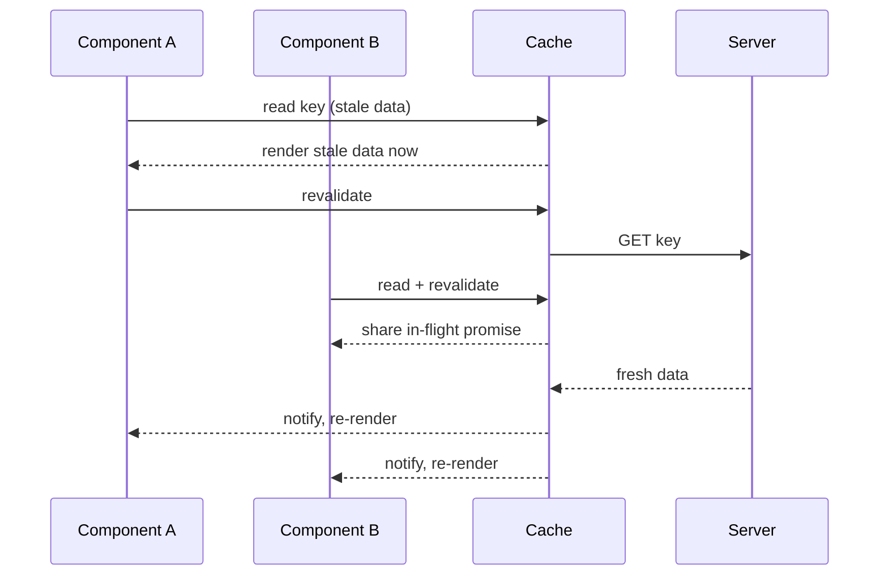

<!-- Generated by scripts/generate-docs.ts from src/catalog. Do not edit by hand. -->

# useRequest

> A minimal stale-while-revalidate cache: shared by key, deduplicated, with optimistic mutate.

🔴 advanced · React 18.0+ · Custom Hooks › Data fetching & async · support: universal

**Playground:** `npm run dev` → [`#/entry/use-request`](http://localhost:5173/#/entry/use-request)

## Concept

A per-key cache entry `{ data, error, updatedAt, isValidating }` read through `useSyncExternalStore`. Concurrent requests for a key share one promise; cached data renders instantly and is revalidated when older than `staleTimeMs`; `mutate` writes locally and wins over responses that started earlier.

## Problem

`useFetch` in five components means five requests and five loading spinners. Sharing, deduplicating and optimistic updates are what SWR/TanStack Query do — this hook shows the core mechanics in ~150 lines.

## When to use

- Learning and teaching how SWR-style caches work.
- Tiny apps or prototypes where a dependency is not wanted.

## When not to use

- Production server state (caching, deduplication, background refetch, SSR hydration) — use [TanStack Query](https://tanstack.com/query/latest), [SWR](https://swr.vercel.app/) or your framework’s data loader (Next.js, React Router).
- Anything needing cache garbage collection, retries, refetch on focus/reconnect, pagination or devtools — not implemented here on purpose.

## API

```ts
function useRequest<T>(
  key: string | null,
  fetcher: (key: string) => Promise<T>,
  options?: { cache?: RequestCache; staleTimeMs?: number },
): {
  data: T | undefined;
  error: Error | undefined;
  isLoading: boolean;
  isValidating: boolean;
  revalidate: () => Promise<void>;
  mutate: (
    next: T | ((current: T | undefined) => T),
    options?: { revalidate?: boolean },
  ) => Promise<void>;
};
```

| Parameter                          | Type                  | Description                                                                           |
| ---------------------------------- | --------------------- | ------------------------------------------------------------------------------------- |
| `key`                              | `string \| null`      | Identifies the data (and its type). `null` skips.                                     |
| `fetcher`                          | `(key) => Promise<T>` | Latest function is used.                                                              |
| `options.cache` _(optional)_       | `RequestCache`        | From `createRequestCache()`. Default: a module-level cache. Use a fresh one per test. |
| `options.staleTimeMs` _(optional)_ | `number`              | Freshness window. Default `2000`.                                                     |

**Returns:** Cached data/error, loading flags and stable `revalidate`/`mutate`.

## Implementation

- [`src/hooks/async/useRequest.ts`](../../src/hooks/async/useRequest.ts)

## Interactive example

- [`src/examples/custom-hooks/async/UseRequestDemo.tsx`](../../src/examples/custom-hooks/async/UseRequestDemo.tsx)

## Execution flow

1. Render: the entry for `key` is read with `useSyncExternalStore` (server snapshot: none).
2. Effect: if the entry is missing, failed or stale, `revalidate` runs — sharing an in-flight request when one exists.
3. Settle: the response is discarded if a `mutate` happened after it started (logical clock), otherwise stored and every subscriber re-renders.
4. Unmount: only the subscription is removed; shared requests keep running and fill the cache.

## Diagram: Stale-while-revalidate with deduplication

Two components mount with the same key while the cache is stale.



## Common mistakes

### Same key, different data shapes

❌ Incorrect:

```tsx
useRequest('/api/user', getUser);
useRequest('/api/user', getUserName); // returns string
```

The cache is keyed by string only; the second component receives the first one’s data type.

## Edge cases

- Errors keep the previous `data` (stale-while-error).
- Entries are never evicted; `cache.clear()` resets everything.

## Browser support

Never reads the shared cache on the server (no cross-request leaks).

## Testing

Tests prove one MSW request for three mounted readers, fresh-cache hits without refetching, background revalidation of stale data, mutate-vs-in-flight races and error handling.

- [`src/hooks/async/useRequest.test.tsx`](../../src/hooks/async/useRequest.test.tsx)
- [`src/hooks/async/async.ssr.test.tsx`](../../src/hooks/async/async.ssr.test.tsx)
- [`src/examples/custom-hooks/async/AsyncDemos.test.tsx`](../../src/examples/custom-hooks/async/AsyncDemos.test.tsx)

## Production considerations

- Use TanStack Query or SWR: they add GC, retries, focus/reconnect refetch, SSR hydration and devtools.

## Related

- [useFetch](use-fetch.md)
- [useResource](use-resource.md)
- [useAsyncFn](use-async-fn.md)
- [useSyncExternalStore](https://react.dev/reference/react/useSyncExternalStore) (official docs)
- [SWR](https://swr.vercel.app/) (official docs)
- [TanStack Query](https://tanstack.com/query/latest) (official docs)
