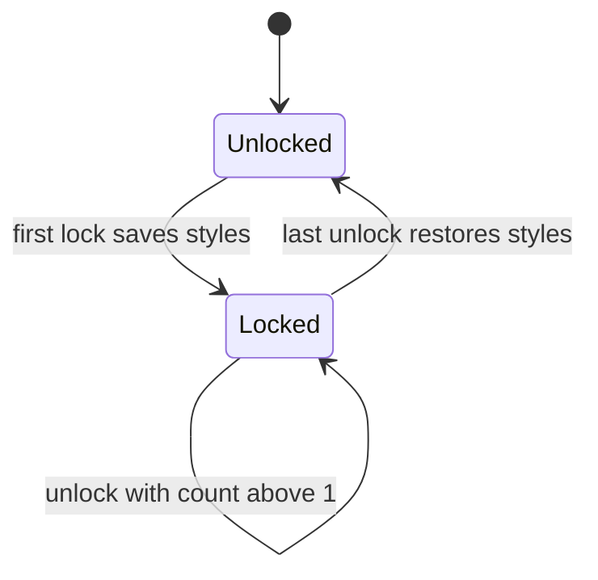

<!-- Generated by scripts/generate-docs.ts from src/catalog. Do not edit by hand. -->

# useScrollLock

> Lock page scrolling for modals with scrollbar-gap compensation, exact style restoration and nested-lock counting.

🟡 intermediate · React 16.8+ · Custom Hooks › Browser & DOM · support: client-only

**Playground:** `npm run dev` → [`#/entry/use-scroll-lock`](http://localhost:5173/#/entry/use-scroll-lock)

## Concept

While `locked`, sets `overflow: hidden` on `body` and adds the scrollbar width to its `padding-right`. A module-level counter lets several components lock at once; the first lock saves the inline styles and the last unlock restores them.

## Problem

Naive versions set `overflow = ""` on close (destroying styles the page had), shift the layout when the scrollbar disappears, and unlock the page while a second overlay is still open.

## When to use

- Custom modals, drawers, full-screen menus and lightboxes.

## When not to use

- Non-modal popovers, menus and toasts: the page should stay scrollable behind them.

## API

```ts
function useScrollLock(locked?: boolean, options?: { reserveScrollbarGap?: boolean }): void;
```

| Parameter                                  | Type      | Description                                                                       |
| ------------------------------------------ | --------- | --------------------------------------------------------------------------------- |
| `locked` _(optional)_                      | `boolean` | Default `true`.                                                                   |
| `options.reserveScrollbarGap` _(optional)_ | `boolean` | Pad `body` by the scrollbar width. Default `true`; decided by the outermost lock. |

**Returns:** Nothing.

## Implementation

- [`src/hooks/browser/useScrollLock.ts`](../../src/hooks/browser/useScrollLock.ts)

## Interactive example

- [`src/examples/custom-hooks/browser/UseScrollLockDemo.tsx`](../../src/examples/custom-hooks/browser/UseScrollLockDemo.tsx)

## Execution flow

1. Layout effect (before paint) when `locked`: increments the counter; on the first lock saves inline `overflow`/`padding-right`, measures `innerWidth - clientWidth` and applies the styles.
2. Cleanup (unmount or `locked` → false): decrements; at zero restores the saved inline styles exactly.

## Diagram: Nested locks

Only the transition from 0 to 1 lock and back changes styles.



## Common mistakes

### Resetting instead of restoring

❌ Incorrect:

```tsx
useEffect(() => {
  document.body.style.overflow = 'hidden';
  return () => {
    document.body.style.overflow = '';
  };
}, []);
```

Wipes an inline style the page had, and the first of two nested modals to close unlocks the page while the other is still open.

## Edge cases

- `position: fixed` elements are not padded and may still shift — or use `scrollbar-gutter: stable` on `html`.
- Overlay scrollbars (macOS default, mobile) have zero width, so no padding is added.
- Scrollable content inside the overlay still scrolls; add `overscroll-behavior: contain` to stop scroll chaining.
- A native `<dialog>` opened with `showModal()` makes the page inert but does not stop it scrolling — lock it with this hook too.

## Browser support

iOS Safari before 16 ignores `overflow: hidden` on `body` for touch scrolling. No-op on the server.

## Testing

Tests assert locking, exact restoration of pre-existing inline styles, padding compensation (with an overridden `clientWidth`), opting out, and nested reference counting.

- [`src/hooks/browser/useScrollLock.test.tsx`](../../src/hooks/browser/useScrollLock.test.tsx)
- [`src/examples/custom-hooks/browser/UseScrollLockDemo.test.tsx`](../../src/examples/custom-hooks/browser/UseScrollLockDemo.test.tsx)

## Related

- [useClickOutside](use-click-outside.md)
- [useScrollPosition](use-scroll-position.md)
- [MDN: overflow](https://developer.mozilla.org/en-US/docs/Web/CSS/Reference/Properties/overflow) (official docs)
- [MDN: scrollbar-gutter](https://developer.mozilla.org/en-US/docs/Web/CSS/Reference/Properties/scrollbar-gutter) (official docs)
