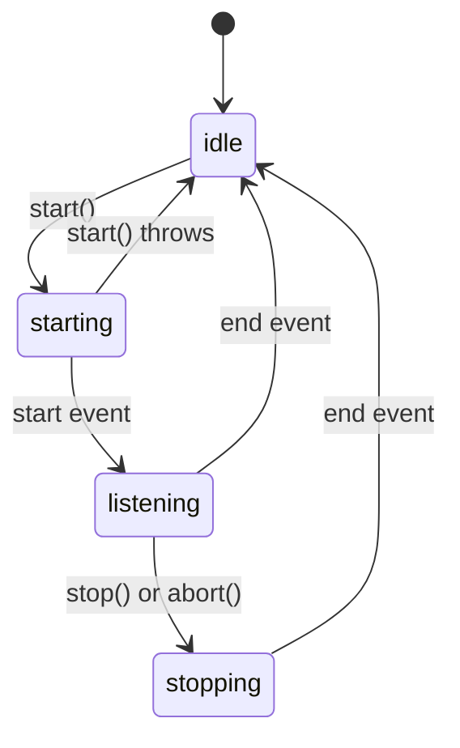

<!-- Generated by scripts/generate-docs.ts from src/catalog. Do not edit by hand. -->

# useSpeechRecognition

> Speech-to-text with the Web Speech API: start/stop/abort, interim results, error states, mic permission on demand.

🔴 advanced · React 16.8+ · Custom Hooks › Device & preferences · support: browser-limited

**Playground:** `npm run dev` → [`#/entry/use-speech-recognition`](http://localhost:5173/#/entry/use-speech-recognition)

## Concept

Creates a `SpeechRecognition` instance on `start()`, maps its `start`/`result`/`error`/`end` events onto a reducer (`status`, `transcript`, `interimTranscript`, `error`) and aborts it on unmount.

## Problem

The API is event-heavy and stateful: calling `start()` twice throws, `abort()` reports an `aborted` “error”, interim and final results arrive in one list, and forgetting to abort keeps the microphone open after navigation.

## When to use

- Optional voice input next to a text field: search, notes, accessibility helpers.

## When not to use

- Sensitive input (passwords, health data): Chrome streams audio to a server-based recognition service.
- As the only input method — Firefox has no support; always keep a keyboard path.
- Offline or high-accuracy transcription — use a dedicated speech service with explicit consent.

## API

```ts
function useSpeechRecognition(options?: {
  lang?: string;
  continuous?: boolean;
  interimResults?: boolean;
  onResult?: (result) => void;
}): SpeechRecognitionControls;
```

| Parameter                             | Type                                            | Description                                          |
| ------------------------------------- | ----------------------------------------------- | ---------------------------------------------------- |
| `options.lang` _(optional)_           | `string`                                        | BCP 47 tag. Defaults to `<html lang>`.               |
| `options.continuous` _(optional)_     | `boolean`                                       | Keep listening across pauses. Default `false`.       |
| `options.interimResults` _(optional)_ | `boolean`                                       | Report partial results. Default `true`.              |
| `options.onResult` _(optional)_       | `({ transcript, confidence, isFinal }) => void` | Called for every result; always the latest callback. |

**Returns:** `{ isSupported, status: "idle" | "starting" | "listening" | "stopping", listening, transcript, interimTranscript, error: { code, message } | null, start, stop, abort, reset }`.

## Implementation

- [`src/hooks/device/useSpeechRecognition.ts`](../../src/hooks/device/useSpeechRecognition.ts)

## Interactive example

- [`src/examples/custom-hooks/device/UseSpeechRecognitionDemo.tsx`](../../src/examples/custom-hooks/device/UseSpeechRecognitionDemo.tsx)

## Execution flow

1. Mount: nothing is created and no permission is requested.
2. `start()` (from a click): a new instance is configured from the latest options and started; the browser may prompt for the microphone.
3. Events: `start` → listening; `result` → final text appended, interim replaced; `error` → `error` (except `aborted`); `end` → idle and listeners detached.
4. Unmount: listeners are detached and the session is aborted.

## Diagram: Recognition lifecycle

Status transitions driven by user actions and browser events.



## Common mistakes

### Starting on mount

❌ Incorrect:

```tsx
useEffect(() => {
  recognition.start();
}, []);
```

The permission prompt appears without context (users tend to deny it), and with no cleanup the Strict Mode remount calls `start()` on a running session, which throws `InvalidStateError`.

✅ Correct:

```tsx
<button onClick={speech.start}>Start dictation</button>
```

## Edge cases

- `not-allowed` covers both a denied prompt and an insecure (http) page.
- `no-speech` fires after a few seconds of silence; `network` when Chrome’s service is unreachable.
- Option changes apply to the next `start()`, not the running session.

## Browser support

Chromium-based browsers and Safari (prefixed `webkitSpeechRecognition`); not Firefox. Needs a secure context and microphone permission.

## Testing

A `FakeRecognition` class (an `EventTarget`) is stubbed on `window`; tests dispatch result/error/end events and cover webkit detection, the `aborted` non-error, `start()` throwing, and abort + listener removal on unmount.

- [`src/hooks/device/useSpeechRecognition.test.tsx`](../../src/hooks/device/useSpeechRecognition.test.tsx)
- [`src/hooks/device/device.ssr.test.tsx`](../../src/hooks/device/device.ssr.test.tsx)
- [`src/examples/custom-hooks/device/DeviceDemos.test.tsx`](../../src/examples/custom-hooks/device/DeviceDemos.test.tsx)

## Production considerations

- Tell users, before they press Start, where their audio goes.
- Show the interim transcript visually distinct and only act on final results.

## Related

- [useSpeechSynthesis](use-speech-synthesis.md)
- [usePermission](use-permission.md)
- [MDN: Using the Web Speech API](https://developer.mozilla.org/en-US/docs/Web/API/Web_Speech_API/Using_the_Web_Speech_API) (official docs)
- [MDN: SpeechRecognition](https://developer.mozilla.org/en-US/docs/Web/API/SpeechRecognition) (official docs)
