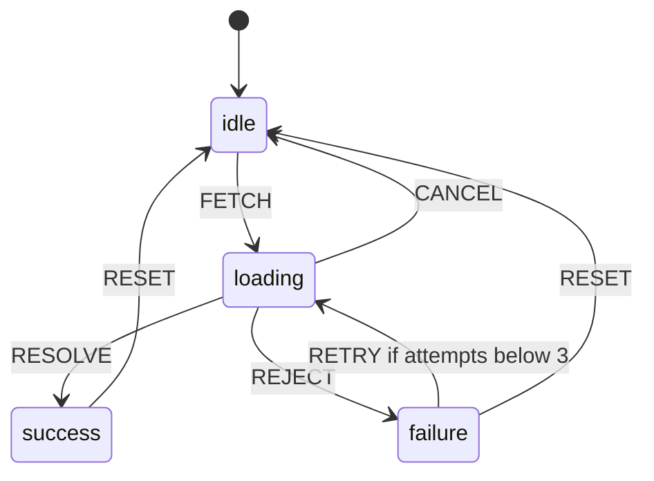

<!-- Generated by scripts/generate-docs.ts from src/catalog. Do not edit by hand. -->

# useStateMachine

> Typed finite state machine on `useReducer`: states, discriminated-union events, guards, context and entry effects with cleanup.

🔴 advanced · React 19.2+ · Custom Hooks › Advanced patterns · support: universal

**Playground:** `npm run dev` → [`#/entry/use-state-machine`](http://localhost:5173/#/entry/use-state-machine)

## Concept

A config lists, per state, which events it accepts (`on`) and where they lead — a target, an object with `guard`/`assign`, or candidates tried in order. A pure `machineTransition` function runs in the reducer; `entry` actions run in an effect when a state is entered and may return a cleanup.

## Problem

Boolean soup (`isLoading && !isError && hasData`) allows impossible combinations and makes it easy to, say, accept a late `RESOLVE` after the user cancelled. A machine makes illegal transitions unrepresentable and ties side effects to states.

## When to use

- Multi-step UI flows: wizards, checkout, media players, upload/retry logic.
- Async lifecycles where cancellation and retries must be correct.

## When not to use

- Two or three independent booleans — `useState` is clearer.
- Hierarchical/parallel states, delayed transitions, actors, history or visual tooling — use XState (with `@xstate/react`), which also handles persistence and inspection.

## API

```ts
function useStateMachine<S extends string, C, E extends { type: string }>(
  config: MachineConfig<S, C, E>,
): {
  value: S;
  context: C;
  send(event: E): void;
  can(event: E): boolean;
  matches(state: S): boolean;
};
```

| Parameter                             | Type                                                        | Description                                                                     |
| ------------------------------------- | ----------------------------------------------------------- | ------------------------------------------------------------------------------- |
| `config.initial / context`            | `S / C`                                                     | Initial state name and extended state (read once).                              |
| `config.states[s].on[type]`           | `S \| { target?, guard?, assign? } \| Array<…>`             | Transitions; the event is narrowed per type. No `target` = context-only update. |
| `config.states[s].entry` _(optional)_ | `({ state, context, event, send }) => void \| (() => void)` | Effect on entering the state; cleanup runs on exit/unmount.                     |

**Returns:** Current state, context, a stable `send`, and `can`/`matches` helpers.

## Implementation

- [`src/hooks/advanced/useStateMachine.ts`](../../src/hooks/advanced/useStateMachine.ts)

## Interactive example

- [`src/examples/custom-hooks/advanced/UseStateMachineDemo.tsx`](../../src/examples/custom-hooks/advanced/UseStateMachineDemo.tsx)

## Execution flow

1. `send(event)` dispatches to `useReducer`; `machineTransition` finds the handler for the current state and tries candidates in order.
2. Rejected events return the same snapshot, so React bails out of rendering.
3. Commit: if the state was entered (`value` or `version` changed), the previous entry cleanup runs, then the new `entry` (via `useEffectEvent`, so it sees fresh context).

## Diagram: The demo machine

Fetch with cancel, guarded retries and reset.



## Common mistakes

### Side effects in guards or assign

❌ Incorrect:

```tsx
assign: (ctx) => {
  fetch('/api/save');
  return ctx;
};
```

They run inside the reducer, which React may call twice (Strict Mode) or replay. Put side effects in `entry`.

## Edge cases

- A transition with an explicit `target` equal to the current state re-enters it (entry runs again).
- Strict Mode runs entry effects twice on mount in development; cleanups must undo them (e.g. abort the request).

## Testing

The pure `machineTransition` is unit-tested directly; hook tests cover ignored events, guard fallbacks, `can()`, entry/cleanup ordering, timers sending events, and cleanup on unmount. The demo test drives a real retry flow against the MSW `/api/flaky` endpoint.

- [`src/hooks/advanced/useStateMachine.test.tsx`](../../src/hooks/advanced/useStateMachine.test.tsx)
- [`src/hooks/advanced/advanced.ssr.test.tsx`](../../src/hooks/advanced/advanced.ssr.test.tsx)
- [`src/examples/custom-hooks/advanced/AdvancedNetworkDemos.test.tsx`](../../src/examples/custom-hooks/advanced/AdvancedNetworkDemos.test.tsx)

## Related

- [useReducer — typed actions, lazy init & undo](../built-in-hooks/use-reducer.md)
- [useEffectEvent — non-reactive logic in effects](../built-in-hooks/use-effect-event.md)
- [useOptimisticMutation](use-optimistic-mutation.md)
- [useReducer](https://react.dev/reference/react/useReducer) (official docs)
- [useEffectEvent](https://react.dev/reference/react/useEffectEvent) (official docs)
- [XState documentation](https://stately.ai/docs) (official docs)
