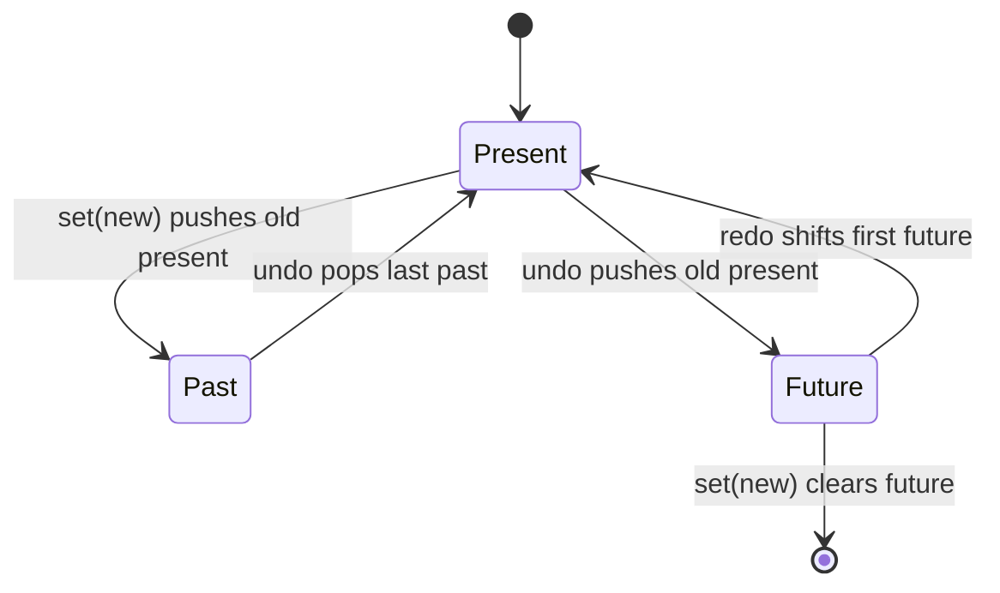

<!-- Generated by scripts/generate-docs.ts from src/catalog. Do not edit by hand. -->

# useUndoRedo

> Undo/redo history (past/present/future) with a pure reducer, a history limit and coalescing.

🔴 advanced · React 16.8+ · Custom Hooks › State utilities · support: universal

**Playground:** `npm run dev` → [`#/entry/use-undo-redo`](http://localhost:5173/#/entry/use-undo-redo)

## Concept

A reducer manages `past`, `present` and `future` stacks. `set` pushes the old present onto `past` and clears `future`; `undo`/`redo` move one state between the stacks. Impure inputs (the timestamp for coalescing, the options) travel in the action, so the reducer stays pure.

## Problem

Ad-hoc history with several `useState` calls gets out of sync, forgets to clear the redo stack, grows without bound, and records every keystroke as its own undo step.

## When to use

- Editors, drawing tools, form builders, any UI where users expect Ctrl/⌘+Z.

## When not to use

- Huge documents: snapshots of the whole state are kept — store patches (Immer `produceWithPatches`) or commands instead.
- A timestamped log with `go(index)` navigation ("useStateWithHistory") was intentionally **not** added: it is the same past/present/future model (the timeline is `[...past, present, ...future]`), so a second hook would only duplicate this one.
- Collaborative editing — history must be per user and merged (CRDT/OT libraries).

## API

```ts
function useUndoRedo<T>(
  initialPresent: T,
  options?: { limit?: number; coalesceWindowMs?: number },
): {
  present: T;
  past: readonly T[];
  future: readonly T[];
  canUndo: boolean;
  canRedo: boolean;
  set(next: SetStateAction<T>, options?: { coalesceKey?: string }): void;
  undo(): void;
  redo(): void;
  reset(present?: T): void;
};
```

| Parameter                               | Type     | Description                                                                       |
| --------------------------------------- | -------- | --------------------------------------------------------------------------------- |
| `initialPresent`                        | `T`      | Initial state; also the default for `reset()`.                                    |
| `options.limit` _(optional)_            | `number` | Max undo steps kept (default unlimited).                                          |
| `options.coalesceWindowMs` _(optional)_ | `number` | Max gap between `set` calls sharing a `coalesceKey` to merge them (default 1000). |

**Returns:** The history state and stable actions.

## Implementation

- [`src/hooks/state/useUndoRedo.ts`](../../src/hooks/state/useUndoRedo.ts)

## Interactive example

- [`src/examples/custom-hooks/state/UseUndoRedoDemo.tsx`](../../src/examples/custom-hooks/state/UseUndoRedoDemo.tsx)

## Execution flow

1. `set` reads `Date.now()` in the event handler and dispatches it with the value or updater.
2. The reducer resolves the updater, ignores `Object.is`-equal values, merges into the current step when the coalesce key matches within the window, otherwise pushes a new step and trims to `limit`.
3. `undo`/`redo` also end the current coalescing group.

## Diagram: History transitions

How set, undo and redo move states between the three stacks.



## Common mistakes

### Mutating a snapshot

❌ Incorrect:

```tsx
history.present.items.push(item);
history.set(history.present);
```

The same object is referenced from `past`, so undo "restores" the mutated version — and `Object.is` makes the set a no-op.

✅ Correct:

```tsx
history.set((doc) => ({ ...doc, items: [...doc.items, item] }));
```

## Edge cases

- Undo/redo at the ends of the history are no-ops (same state object).
- A coalesced change never merges into the initial state: the first change of a burst is always its own step.
- Keyboard shortcuts in the demo override the native input undo while focus is in the title field, keeping one consistent history.

## Testing

Tests cover undo/redo, clearing the redo stack, no-ops, the history limit, time-based coalescing with fake timers, reset, stable actions and reducer purity; the demo test drives buttons and Ctrl/⌘+Z.

- [`src/hooks/state/useUndoRedo.test.tsx`](../../src/hooks/state/useUndoRedo.test.tsx)
- [`src/examples/custom-hooks/state/UseUndoRedoDemo.test.tsx`](../../src/examples/custom-hooks/state/UseUndoRedoDemo.test.tsx)

## Production considerations

- Bind both Ctrl+Z and ⌘+Z, plus Shift+Z / Ctrl+Y for redo, and expose visible buttons for pointer and assistive-technology users.
- Persisting history? Store only `present` unless users expect history to survive reloads.

## Related

- [useList](use-list.md)
- [usePrevious](use-previous.md)
- [useEventListener](use-event-listener.md)
- [useReducer](https://react.dev/reference/react/useReducer) (official docs)
- [Extracting state logic into a reducer](https://react.dev/learn/extracting-state-logic-into-a-reducer) (official docs)
