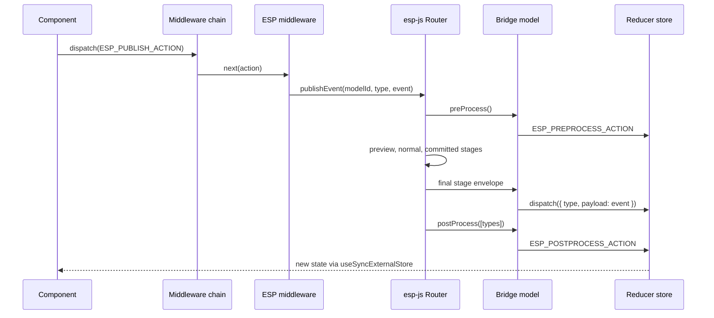

<!-- Generated by scripts/generate-docs.ts from src/catalog. Do not edit by hand. -->

# ESP-JS middleware for React hooks — architecture

> How the original esp-js wrapper connects an event router to React reducers through dispatch middleware.

🔴 advanced · React 19.0+ · ESP-JS Integration › ESP-JS integration

**Playground:** `npm run dev` → [`#/entry/esp-middleware-overview`](http://localhost:5173/#/entry/esp-middleware-overview)

## Concept

Each React store (a reducer + middleware chain) registers a _model_ with an esp-js `Router`. Two special actions — `ESP_PUBLISH_ACTION` (one model) and `ESP_BROADCAST_ACTION` (every observing model) — are intercepted by the ESP middleware and routed through esp-js. A bridge subscribes to the model's events and dispatches them back into the reducer as ordinary actions (`{ type: eventType, payload: event }`).

## Problem

Independent widgets ("tiles") in a large workspace need to react to each other's events without sharing one global store or lifting state to a common ancestor, while keeping each widget's state local, testable and reducer-driven.

## When to use

- Your application already uses esp-js models and you want React function components and hooks to participate in the same event flow.
- Many independently mounted widgets must exchange events (publish to one, broadcast to many) with a deterministic, run-to-completion event loop.
- You need esp-js observation stages (preview → normal → committed → final) to filter, cancel or commit events before state changes.

## When not to use

- A small app: lift state up, use context, or a store such as Zustand/Redux Toolkit. A router adds indirection and string-typed events.
- Server state: use TanStack Query, SWR or your framework's data APIs.
- When components only need to share state (not events): an external store with `useSyncExternalStore` is simpler.

## API

```ts
function useEspReducer<S, A extends { type: string }>(
  reducer: Reducer<S, EspStoreAction<A>>,
  initialState: S,
  options: UseEspReducerOptions<S, A>,
): readonly [state: S, dispatch: Dispatch<EspStoreAction<A>>, esp: EspStoreHandle];
```

| Parameter                                         | Type                                | Description                                                                                         |
| ------------------------------------------------- | ----------------------------------- | --------------------------------------------------------------------------------------------------- |
| `reducer`                                         | `Reducer<S, EspStoreAction<A>>`     | Pure reducer. Also receives routed events and `ESP_PREPROCESS`/`ESP_POSTPROCESS` lifecycle actions. |
| `initialState`                                    | `S`                                 | Initial state (captured on mount).                                                                  |
| `options.modelName`                               | `string`                            | Prefix of the model id; a `useId` suffix keeps instances unique.                                    |
| `options.observedEvents`                          | `string[]`                          | Event types this model receives. esp-js 8 drops events a model does not observe.                    |
| `options.middleware` _(optional)_                 | `Middleware[]`                      | Middleware running before the ESP middleware (outermost first).                                     |
| `options.filters / commitEventTypes` _(optional)_ | `Record<string, filter> / string[]` | Preview-stage cancellation and normal-stage commits.                                                |
| `options.onStage / onError` _(optional)_          | `callbacks`                         | Tracing for every stage; errors thrown while dispatching routed events.                             |
| `options.router` _(optional)_                     | `Router`                            | Defaults to `<EspRouterProvider>`'s router, else the shared workspace router.                       |

**Returns:** The state, a stable `dispatch`, and `{ modelId, router, publish(eventType, event), broadcast(eventType, event) }`.

## Implementation

- [`src/middleware/esp-js/espMiddleware.ts`](../../src/middleware/esp-js/espMiddleware.ts)
- [`src/middleware/esp-js/bridge.ts`](../../src/middleware/esp-js/bridge.ts)
- [`src/middleware/esp-js/useEspReducer.ts`](../../src/middleware/esp-js/useEspReducer.ts)
- [`src/middleware/esp-js/useEspBridge.ts`](../../src/middleware/esp-js/useEspBridge.ts)
- [`src/middleware/esp-js/router.ts`](../../src/middleware/esp-js/router.ts)
- [`src/middleware/esp-js/index.ts`](../../src/middleware/esp-js/index.ts)

## Interactive example

- [`src/examples/esp-js/EspVsReducerDemo.tsx`](../../src/examples/esp-js/EspVsReducerDemo.tsx)

## Execution flow

1. Mount: `useState` creates the store with `[...middleware, espMiddleware]` once; the state is read with `useSyncExternalStore`.
2. Commit (effect): the bridge registers the model with the router and subscribes to each observed event type. Strict Mode registers, removes and re-registers it.
3. `esp.publish(type, event)` dispatches `ESP_PUBLISH_ACTION`; the middleware calls `router.publishEvent(modelId, type, event)` and swallows the action.
4. The router runs its dispatch loop: `preProcess` → preview → normal → (committed) → final → `postProcess` for each model with queued events.
5. At the final stage the bridge dispatches `{ type, payload: event }` into the store; the reducer updates and React re-renders subscribers.
6. Unmount: subscriptions are disposed and the model is removed from the router.

## Diagram: ESP-JS event propagation through the middleware

A component dispatches a publish action; the ESP middleware routes it to the esp-js router, which runs the observation stages and the bridge dispatches the final-stage event back into the reducer.



## Common mistakes

### Registering the model during render (the original bug)

❌ Incorrect:

```tsx
const [state, dispatch] = useReducer(reducer, initialState);
// runs on every render → a new model + subscription each time
const [espDispatch] = applyESPMiddleware(state.modelId, dispatch);
```

Render must be pure. Every render created a bridge model and a router subscription that was never disposed, which is why the original demo asked you to refresh the preview when tiles stopped responding.

✅ Correct:

```tsx
const [state, dispatch, esp] = useEspReducer(reducer, initialState, {
  modelName: 'accumulators',
  observedEvents: [KEY_PRESSED],
});
```

### Letting a reducer exception reach esp-js

❌ Incorrect:

```tsx
router.getEventObservable(id, type).subscribe((env) => dispatch({ type, payload: env.event }));
```

Any exception inside an esp-js observer halts the router permanently (status `halted`), breaking every model on it.

✅ Correct:

```tsx
Use `registerEspBridge`/`useEspReducer`, which wrap dispatch, report via `onError` and keep the router running.
```

## Edge cases

- Publishing to an unregistered model throws inside esp-js; the middleware catches it and calls `onError` (default: `console.error`).
- Events published from inside a handler are queued and processed after the current event (run-to-completion).
- Two stores with the same model id would receive each other's events, so registration throws on duplicates.
- esp-js 8 ships a UMD bundle that references `self` at import time, so it cannot be imported during Node SSR without a `globalThis.self` shim. The playground is client-rendered.

## Testing

Store-level tests route publish/broadcast between models, verify lifecycle actions, unobserved-event dropping, preview cancellation, commit stages, router-halt protection and duplicate ids. Hook tests run two components under Strict Mode on one router and assert model removal on unmount.

- [`src/middleware/esp-js/esp.test.tsx`](../../src/middleware/esp-js/esp.test.tsx)
- [`src/middleware/esp-js/esp.ssr.test.ts`](../../src/middleware/esp-js/esp.ssr.test.ts)
- [`src/examples/esp-js/EspExamples.test.tsx`](../../src/examples/esp-js/EspExamples.test.tsx)

## Production considerations

- Prefer one router per workspace/shell, provided with `<EspRouterProvider>`; create a fresh router per test.
- Type event payloads by declaring each observed event as a member of your action union.
- Use `onStage` for diagnostics in development only; it runs for every stage of every event.

## Related

- [Original workspace & tiles (migrated)](esp-original-workspace.md)
- [Observation stages, filtering & commits](esp-stages-and-filtering.md)
- [Error isolation: keeping the router alive](esp-error-isolation.md)
- [Migration: esp-js 2 + React 16.8 → esp-js 8 + React 19](esp-migration-notes.md)
- [useReducer + dispatch middleware](../state-management/reducer-middleware-pipeline.md)
- [Choosing a state approach](../state-management/state-management-comparison.md)
- [esp-js on GitHub](https://github.com/esp/esp-js) (official docs)
- [esp-js on npm](https://www.npmjs.com/package/esp-js) (official docs)
- [useSyncExternalStore](https://react.dev/reference/react/useSyncExternalStore) (official docs)
- [Redux middleware](https://redux.js.org/understanding/history-and-design/middleware) (official docs)
