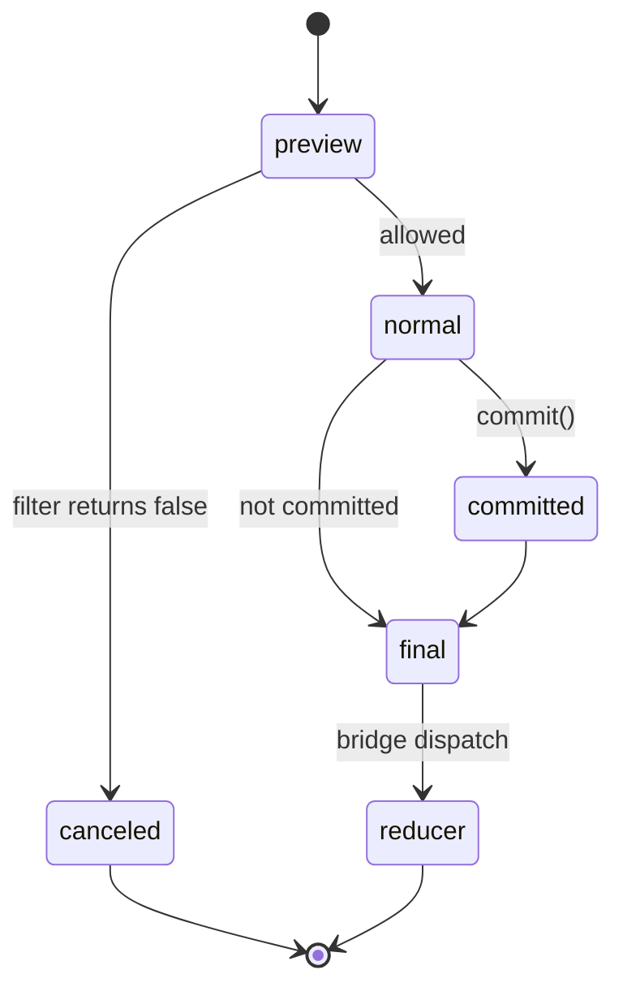

<!-- Generated by scripts/generate-docs.ts from src/catalog. Do not edit by hand. -->

# Observation stages, filtering & commits

> Cancel events at the preview stage and commit them at the normal stage before they reach React state.

🔴 advanced · React 19.0+ · ESP-JS Integration › ESP-JS integration

**Playground:** `npm run dev` → [`#/entry/esp-stages-and-filtering`](http://localhost:5173/#/entry/esp-stages-and-filtering)

## Concept

esp-js dispatches each event through ordered stages. The bridge observes `preview` to run per-event-type filters (returning `false` cancels the event), optionally commits at `normal` (which enables `committed`), and forwards `final`-stage events to the reducer.

## Problem

Some events must be vetted (risk limits, permissions, stale data) by a separate concern before any state changes, without each reducer re-implementing the check.

## When to use

- Cross-cutting guards on routed events, e.g. risk limits, entitlements, kill switches.

## When not to use

- Validation of local form input — validate in the event handler or in reducer middleware (see the workspace validation middleware).

## Implementation

- [`src/examples/esp-js/EspStagesDemo.tsx`](../../src/examples/esp-js/EspStagesDemo.tsx)
- [`src/middleware/esp-js/bridge.ts`](../../src/middleware/esp-js/bridge.ts)

## Interactive example

- [`src/examples/esp-js/EspStagesDemo.tsx`](../../src/examples/esp-js/EspStagesDemo.tsx)

## Execution flow

1. preview: the filter runs with the latest props (read through a ref); `false` → `context.cancel()`.
2. normal: if the event type is in `commitEventTypes`, `context.commit()`.
3. committed: runs only for committed events.
4. final: the bridge dispatches into the reducer.

## Diagram: esp-js observation stages used by the bridge

An event passes preview, where it may be canceled, then normal, committed and final, where it is dispatched to the reducer.

## Testing

Tests assert canceled events never reach the reducer and that committed events pass through every stage in order.

- [`src/examples/esp-js/EspExamples.test.tsx`](../../src/examples/esp-js/EspExamples.test.tsx)
- [`src/middleware/esp-js/esp.test.tsx`](../../src/middleware/esp-js/esp.test.tsx)

## Related

- [ESP-JS middleware for React hooks — architecture](esp-middleware-overview.md)
- [Error isolation: keeping the router alive](esp-error-isolation.md)
- [esp-js on GitHub](https://github.com/esp/esp-js) (official docs)
