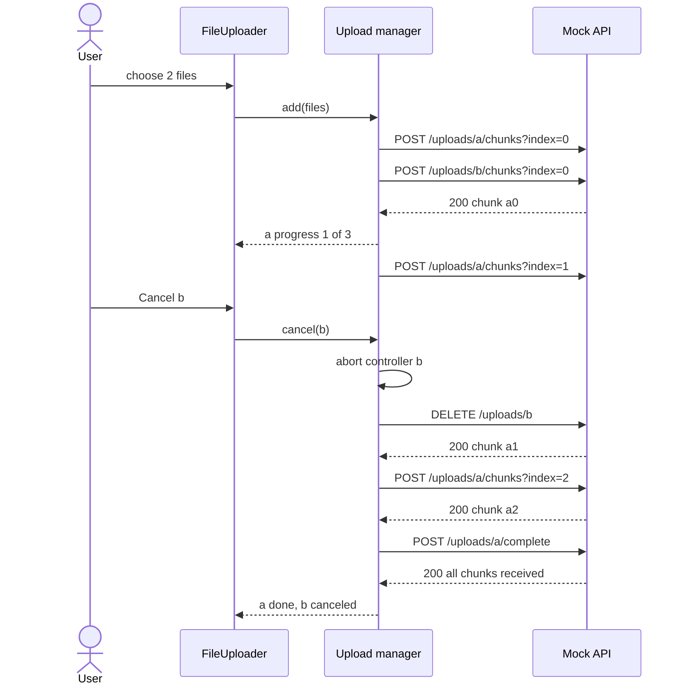

<!-- Generated by scripts/generate-docs.ts from src/catalog. Do not edit by hand. -->

# Chunked file upload with cancel and retry

> Picker + drop zone, client-side validation, chunked uploads with per-file progress, cancel, resumable retry and a concurrency limit — against a mocked endpoint.

🔴 advanced · React 18.0+ · Real-World Scenarios › Files & media

**Playground:** `npm run dev` → [`#/entry/chunked-file-upload`](http://localhost:5173/#/entry/chunked-file-upload)

## Concept

An upload manager outside React (built on `createStore`) owns the queue: each file is split with `Blob.slice` and its chunks are POSTed one after another to `/api/uploads/:id/chunks?index=N&total=M`, at most _N_ files at a time. Components read the queue with `useExternalStore`; `File` objects and `AbortController`s stay outside state.

## Problem

Large uploads fail halfway on flaky networks, users need to see progress and cancel one file without losing the others, and firing every file at once saturates the connection.

## When to use

- Uploads of large files or many files, where resumability and progress matter.
- When the server (or object storage multipart API) accepts chunked uploads.

## When not to use

- Small single files: a plain `<form>` or one `fetch` with `FormData` is enough.
- Production uploads to S3/GCS/Azure: use their multipart/resumable protocols (or tus/Uppy), which add checksums, server-side resume and expiry.
- `fetch` does not report upload progress _within_ a request; if you need byte-level progress of one big request use `XMLHttpRequest.upload.onprogress`. Here progress is counted per confirmed chunk.

## Implementation

- [`src/examples/scenarios/file-upload/FileUploadScenario.tsx`](../../src/examples/scenarios/file-upload/FileUploadScenario.tsx)
- [`src/examples/scenarios/file-upload/FileUploader.tsx`](../../src/examples/scenarios/file-upload/FileUploader.tsx)
- [`src/examples/scenarios/file-upload/uploadManager.ts`](../../src/examples/scenarios/file-upload/uploadManager.ts)
- [`src/examples/scenarios/file-upload/validation.ts`](../../src/examples/scenarios/file-upload/validation.ts)
- [`src/mocks/extra/scenariosAdvanced.ts`](../../src/mocks/extra/scenariosAdvanced.ts)
- [`src/hooks/advanced/createStore.ts`](../../src/hooks/advanced/createStore.ts)
- [`src/hooks/advanced/useExternalStore.ts`](../../src/hooks/advanced/useExternalStore.ts)
- [`src/hooks/async/fetchJson.ts`](../../src/hooks/async/fetchJson.ts)

## Interactive example

- [`src/examples/scenarios/file-upload/FileUploadScenario.tsx`](../../src/examples/scenarios/file-upload/FileUploadScenario.tsx)

## Execution flow

1. Pick or drop files → `validateFile` checks emptiness, size and type → rejected files are listed; accepted files are added as `queued`.
2. `pump()` starts queued files while fewer than `concurrency` are `uploading`.
3. Each file loops over its remaining chunks with `fetchJson(…, { signal })`; every confirmed chunk updates `chunksDone`.
4. After the last chunk `POST /complete` verifies that all chunks arrived; the file becomes `done` and a polite announcement is made.
5. Cancel aborts the controller, discards the partial upload (`DELETE`) and frees a slot; a failed chunk marks the file `error` and keeps `chunksDone`, so Retry resumes from the failed chunk.
6. Unmount (`dispose`) aborts every request and stops the queue; mount (`activate`) resumes it — safe under Strict Mode.

## Diagram: Chunked upload with cancel

Chunks are sent sequentially per file; cancel aborts the in-flight chunk and discards the partial upload, while other files keep uploading.

## Edge cases

- A file name containing “fail” makes chunk 2 fail once with 503 (mock) — Retry resumes at chunk 2, not chunk 1.
- Changing the concurrency limit takes effect immediately; changing the chunk size affects newly added files only.
- Dropping a file next to the drop zone is prevented from navigating the page away.
- The same file can be picked twice in a row (the input value is reset).
- `accept` on the input is only a hint: validation runs again on every file, including dropped ones.

## Testing

MSW serves the chunk endpoint with a configurable delay. Tests assert the chunk indexes sent (`server.events`), progress and status per file, validation messages, the concurrency limit, cancelling one file (abort spy + DELETE) while another finishes, resumable retry (`[0, 1, 1, 2]`), dropped files and aborting in-flight requests on unmount.

- [`src/examples/scenarios/file-upload/FileUploadScenario.test.tsx`](../../src/examples/scenarios/file-upload/FileUploadScenario.test.tsx)

## Production considerations

- Validate type and size on the server too — client checks are UX, not security.
- Use idempotent chunk writes (the mock ignores duplicate indexes) and checksums per chunk.
- Expire abandoned partial uploads on the server.
- Retry failed chunks automatically with backoff (`useRetry`/`computeBackoff`) before surfacing an error.

## Related

- [useExternalStore](../custom-hooks/use-external-store.md)
- [useRetry](../custom-hooks/use-retry.md)
- [useAnnouncer](../custom-hooks/use-announcer.md)
- [useEventListener](../custom-hooks/use-event-listener.md)
- [MDN: AbortController](https://developer.mozilla.org/en-US/docs/Web/API/AbortController) (official docs)
- [MDN: Blob.slice()](https://developer.mozilla.org/en-US/docs/Web/API/Blob/slice) (official docs)
- [MDN: File drag and drop](https://developer.mozilla.org/en-US/docs/Web/API/HTML_Drag_and_Drop_API/File_drag_and_drop) (official docs)
