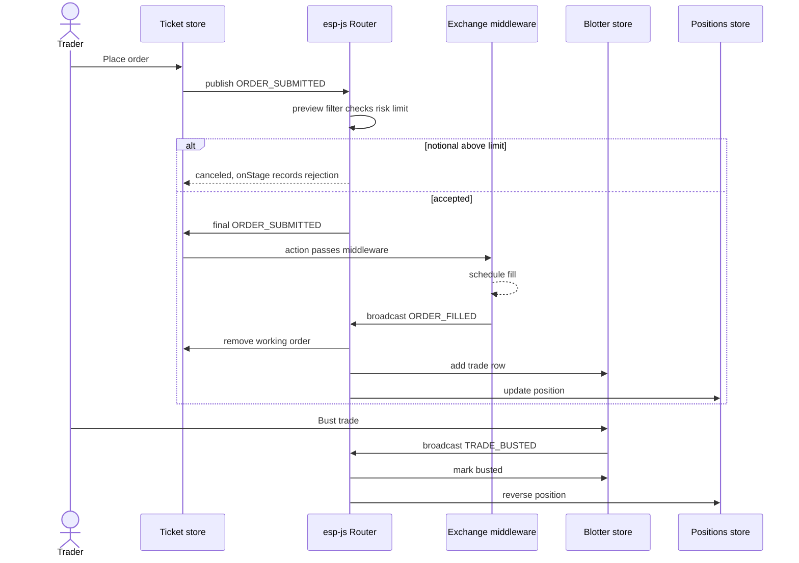

<!-- Generated by scripts/generate-docs.ts from src/catalog. Do not edit by hand. -->

# ESP trading desk: ticket, blotter and positions

> Three independent useEspReducer stores on one esp-js router: a risk-checked order ticket, a trade blotter and a position summary, with an event inspector.

🔴 advanced · React 19.0+ · Real-World Scenarios › Architecture · support: client-only

**Playground:** `npm run dev` → [`#/entry/esp-trading-blotter`](http://localhost:5173/#/entry/esp-trading-blotter)

## Concept

The scenario creates a fresh `new Router()` (in `useState`) and provides it with `<EspRouterProvider>`. The **ticket** publishes `ORDER_SUBMITTED` to its own model; a preview-stage filter cancels orders whose notional exceeds the risk limit, and `commitEventTypes` makes accepted ones pass the committed stage. A **simulated exchange** — plain reducer middleware on the ticket store — schedules a fill for each accepted order and **broadcasts** `ORDER_FILLED`. The **blotter** and **positions** stores observe fills; busting a trade in the blotter broadcasts `TRADE_BUSTED`, which reverses the position. `onStage` from all three stores feeds the inspector.

## Problem

Trading screens are made of independent widgets that must react to the same business events (fills, busts) without importing each other or sharing one global store — and some events must be validated or vetoed before any state changes.

## When to use

- Workspaces of independently mounted tiles that exchange events, especially when the app already uses esp-js models.
- When you need a deterministic, run-to-completion event loop with preview/normal/committed/final stages.

## When not to use

- Shared state without event semantics: an external store or Zustand is simpler.
- Real order routing: risk checks belong on the server; the client filter is a fast pre-check only.

## Implementation

- [`src/examples/scenarios/esp-blotter/EspBlotterScenario.tsx`](../../src/examples/scenarios/esp-blotter/EspBlotterScenario.tsx)
- [`src/examples/scenarios/esp-blotter/TradingDesk.tsx`](../../src/examples/scenarios/esp-blotter/TradingDesk.tsx)
- [`src/examples/scenarios/esp-blotter/trading.ts`](../../src/examples/scenarios/esp-blotter/trading.ts)
- [`src/examples/scenarios/esp-blotter/simulatedExchange.ts`](../../src/examples/scenarios/esp-blotter/simulatedExchange.ts)
- [`src/middleware/esp-js/useEspReducer.ts`](../../src/middleware/esp-js/useEspReducer.ts)
- [`src/middleware/esp-js/bridge.ts`](../../src/middleware/esp-js/bridge.ts)
- [`src/middleware/esp-js/espMiddleware.ts`](../../src/middleware/esp-js/espMiddleware.ts)

## Interactive example

- [`src/examples/scenarios/esp-blotter/EspBlotterScenario.tsx`](../../src/examples/scenarios/esp-blotter/EspBlotterScenario.tsx)

## Execution flow

1. Mount: each `useEspReducer` creates its store once and registers a bridge model in an effect (Strict Mode registers, removes and re-registers).
2. Place order: `esp.publish(ORDER_SUBMITTED, order)` → ESP middleware → `router.publishEvent(ticketModelId, …)`.
3. Preview stage: the filter (always the latest risk limit, no re-registration) cancels or allows the event; a cancellation is traced as `canceled` and recorded as a rejection.
4. Accepted: normal → committed → final; the bridge dispatches `{ type: ORDER_SUBMITTED, payload }` into the ticket store, the exchange middleware lets the reducer run, then starts a fill timer.
5. Timer: the middleware dispatches `espBroadcast(ORDER_FILLED, fill)`; the router delivers it to the ticket (removes the working order), blotter (adds a row) and positions (aggregates).
6. Bust: the blotter broadcasts `TRADE_BUSTED`; blotter and positions update. Unmount: models are removed and pending fill timers cleared.

## Diagram: ESP event flow between the ticket, blotter and positions stores

The ticket publishes to itself through a preview filter; the simulated exchange broadcasts fills to all three stores; the blotter broadcasts busts.

## Edge cases

- Fills and busts are idempotent (duplicate trade ids are ignored), and a second bust changes nothing.
- Raising the risk limit takes effect for the next order immediately.
- Two scenario instances have separate routers: events never cross between them.
- Unmounting with a fill pending cancels it instead of routing into a removed model.

## Browser support

esp-js 8 references `self` when imported, so it cannot be imported during Node SSR without a shim.

## Testing

Pure reducers are unit-tested (idempotency, reversal). The exchange middleware is tested with fake timers and `dispose`. UI tests use a short fill delay and assert the status line, the three stores, the inspector stages (`committed`, `canceled`, `final`, lifecycle), busts, router isolation between two instances and clean unmounting.

- [`src/examples/scenarios/esp-blotter/EspBlotterScenario.test.tsx`](../../src/examples/scenarios/esp-blotter/EspBlotterScenario.test.tsx)

## Production considerations

- Type every event payload and validate events crossing process boundaries.
- Keep `onStage` tracing for development; it runs for every stage of every event.
- Model the exchange connection as its own esp-js model or service instead of middleware when it has state (reconnects, heartbeats).

## Related

- [ESP-JS middleware for React hooks — architecture](../esp-js/esp-middleware-overview.md)
- [Observation stages, filtering & commits](../esp-js/esp-stages-and-filtering.md)
- [Error isolation: keeping the router alive](../esp-js/esp-error-isolation.md)
- [useReducer + dispatch middleware](../state-management/reducer-middleware-pipeline.md)
- [esp-js on GitHub](https://github.com/esp/esp-js) (official docs)
- [useSyncExternalStore](https://react.dev/reference/react/useSyncExternalStore) (official docs)
