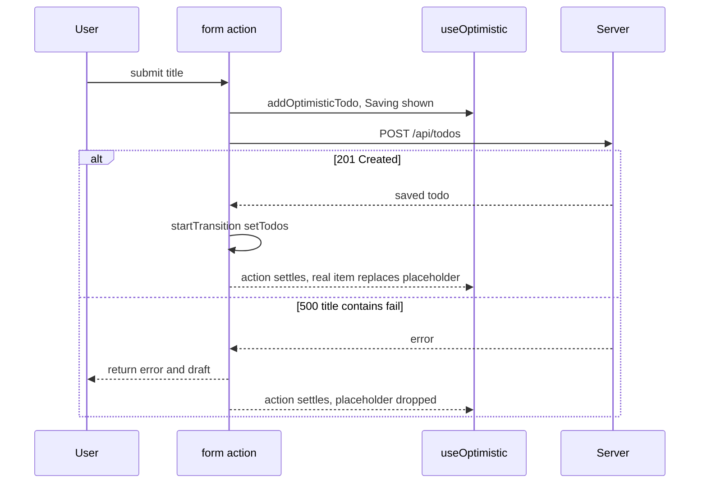

<!-- Generated by scripts/generate-docs.ts from src/catalog. Do not edit by hand. -->

# Form Actions with optimistic updates

> A todo list built from React 19 primitives: <form action>, useActionState for results, useFormStatus for the pending button and useOptimistic with automatic rollback.

🔴 advanced · React 19.0+ · Real-World Scenarios › Forms

**Playground:** `npm run dev` → [`#/entry/form-actions-optimistic`](http://localhost:5173/#/entry/form-actions-optimistic)

## Concept

`<form action={formAction}>` calls the `useActionState` action with the form’s `FormData` inside a transition. The action adds an optimistic todo with `useOptimistic`, awaits `POST /api/todos`, commits the saved todo with `startTransition(setTodos)` and returns `{ error, draft, lastAdded }`. `SubmitButton` reads `useFormStatus()` of its parent form. When the action settles React drops the optimistic value: on success the real todo is already in state, on failure it simply disappears.

## Problem

Hand-written optimistic updates need pending flags, temporary ids, manual rollback on error and care to avoid flashing duplicates — and every form re-implements “disable the button while saving”.

## When to use

- Small mutations where the server almost always agrees (adding, renaming, toggling).
- Forms that should work with progressive enhancement and React’s built-in pending state.

## When not to use

- Mutations that often fail validation on the server — show a pending state instead of a lie.
- Shared server state used across screens: TanStack Query’s mutations with cache updates.
- React 18 apps: use `useOptimisticMutation` from this library instead.

## Implementation

- [`src/examples/scenarios/form-actions-optimistic/FormActionsOptimisticScenario.tsx`](../../src/examples/scenarios/form-actions-optimistic/FormActionsOptimisticScenario.tsx)
- [`src/examples/scenarios/form-actions-optimistic/OptimisticTodoList.tsx`](../../src/examples/scenarios/form-actions-optimistic/OptimisticTodoList.tsx)
- [`src/examples/scenarios/form-actions-optimistic/SubmitButton.tsx`](../../src/examples/scenarios/form-actions-optimistic/SubmitButton.tsx)
- [`src/examples/scenarios/form-actions-optimistic/todosApi.ts`](../../src/examples/scenarios/form-actions-optimistic/todosApi.ts)
- [`src/hooks/async/useAsync.ts`](../../src/hooks/async/useAsync.ts)

## Interactive example

- [`src/examples/scenarios/form-actions-optimistic/FormActionsOptimisticScenario.tsx`](../../src/examples/scenarios/form-actions-optimistic/FormActionsOptimisticScenario.tsx)

## Execution flow

1. Submit: React runs `formAction(formData)` in a transition; `useFormStatus` in the button reports `pending` and the submitted `data`.
2. Empty title → the action returns an error immediately; no request, no optimistic item.
3. `addOptimisticTodo()` renders the placeholder (“Saving…”) at once; `isPending` sets `aria-busy` on the list.
4. Success: `startTransition(() => setTodos(...))` — updates after `await` need their own transition to belong to the action, otherwise the real todo would render before the placeholder is removed.
5. Failure (title contains “fail” → 500): the action returns the error and the typed text. React resets the uncontrolled form after the action, so the input’s `defaultValue={state.draft}` restores the text; the error is linked with `aria-describedby`.
6. Action settles: the optimistic state is discarded and the list shows `todos` again — with the saved item, or without the failed one.

## Diagram: Optimistic update with an Action and rollback

What the user sees while the form action runs, on success and on failure.

## Edge cases

- Actions from the same `useActionState` run one after another; the button is disabled while pending to avoid duplicate todos.
- `useFormStatus` only works in a component rendered _inside_ the `<form>`.
- The optimistic item has a temporary id; never send it to the server or use it in links.

## Testing

Tests leave the act() environment (an awaited act would wait for the whole action) and hold the MSW response with a manual gate to observe the optimistic item, `aria-busy` and the pending button, then release it to assert confirmation or rollback with the error and restored text. Also covered: the real “fail” rule, empty titles without a request, the load error + retry and axe-core.

- [`src/examples/scenarios/form-actions-optimistic/FormActionsOptimisticScenario.test.tsx`](../../src/examples/scenarios/form-actions-optimistic/FormActionsOptimisticScenario.test.tsx)

## Production considerations

- Show failures where the user is looking (inline, as here) and keep the input so retry is one click.
- Make the POST idempotent (a client-generated id) so a retry after a timeout cannot create duplicates.
- With a server framework, the same action can run on the server for progressive enhancement.

## Related

- [<form action={fn}> Actions](../built-in-hooks/form-actions.md)
- [useActionState](../built-in-hooks/use-action-state.md)
- [useFormStatus](../built-in-hooks/use-form-status.md)
- [useOptimistic](../built-in-hooks/use-optimistic.md)
- [useOptimisticMutation](../custom-hooks/use-optimistic-mutation.md)
- [Optimistic updates with rollback](optimistic-rollback.md)
- [react.dev: <form>](https://react.dev/reference/react-dom/components/form) (official docs)
- [react.dev: useActionState](https://react.dev/reference/react/useActionState) (official docs)
- [react.dev: useFormStatus](https://react.dev/reference/react-dom/hooks/useFormStatus) (official docs)
- [react.dev: useOptimistic](https://react.dev/reference/react/useOptimistic) (official docs)
