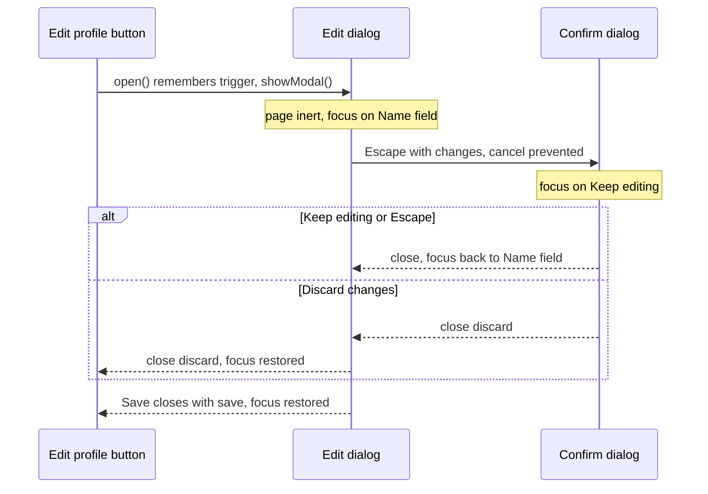

<!-- Generated by scripts/generate-docs.ts from src/catalog. Do not edit by hand. -->

# Modal dialog with nested confirm

> An edit dialog on native <dialog>: focus moves in and back, the page is inert, Escape closes, return values report the outcome and a nested “Discard changes?” only answers the topmost Escape.

🟡 intermediate · React 18.0+ · Real-World Scenarios › Interaction & accessibility · support: universal

**Playground:** `npm run dev` → [`#/entry/modal-dialog`](http://localhost:5173/#/entry/modal-dialog)

## Concept

Two `useDialogState` instances drive two sibling `<dialog>` elements. `showModal()` puts the dialog in the top layer and makes the rest of the document inert, so Tab can only reach the dialog (and browser UI) without any JavaScript trap. The edit form validates with `useForm`; Save closes with `"save"`, Cancel with `"cancel"`, Escape with `""`. With unsaved changes, Cancel or Escape opens an `alertdialog` whose `<form method="dialog">` buttons return `"keep"` or `"discard"`.

## Problem

`
` modals need a focus trap, `aria-hidden` on the rest of the page, an Escape listener per layer, z-index management and manual focus restoration — and nested overlays still close together on one Escape.

## When to use

- Edit forms, confirmations and anything that must block the page until answered.
- Stacked confirmations (“Discard changes?”) on top of another modal.

## When not to use

- Non-blocking content (help popovers, menus): use the Popover API or a disclosure.
- Long multi-step flows: a page is easier to navigate and link to.

## Implementation

- [`src/examples/scenarios/modal-dialog/ModalDialogScenario.tsx`](../../src/examples/scenarios/modal-dialog/ModalDialogScenario.tsx)
- [`src/hooks/accessibility/useDialogState.ts`](../../src/hooks/accessibility/useDialogState.ts)
- [`src/hooks/forms/useForm.ts`](../../src/hooks/forms/useForm.ts)
- [`src/hooks/browser/useScrollLock.ts`](../../src/hooks/browser/useScrollLock.ts)

## Interactive example

- [`src/examples/scenarios/modal-dialog/ModalDialogScenario.tsx`](../../src/examples/scenarios/modal-dialog/ModalDialogScenario.tsx)

## Execution flow

1. “Edit profile”: reset the form to the saved profile, clear the dialog’s `returnValue`, `open()` (which remembers the trigger and calls `showModal()`), then focus the name field.
2. Save: `handleSubmit` validates; on success the profile is stored and `close("save")` fires `close`, which `useDialogState` turns into `isOpen=false`, focus back on the trigger and `onClose("save")`.
3. Escape: the browser fires `cancel` on the topmost modal only. The editor’s `onCancel` calls the hook’s handler, then — if the form is dirty — prevents the close and opens the confirmation.
4. Confirmation: initial focus lands on “Keep editing” (first in DOM order, the least destructive choice). Its `close` returns focus to the element that opened it; `"discard"` also closes the editor, whose own restoration returns focus to “Edit profile”.
5. `useScrollLock(isOpen)` stops the page behind from scrolling — native modals do not do that.

## Diagram: Dialog focus lifecycle

Where focus goes as the edit dialog and its nested confirmation open and close.

## Edge cases

- `returnValue` persists between openings and Escape does not change it, so the scenario resets it before each `open()`; otherwise Escape would report the previous result.
- The confirmation is a sibling of the editor, not a descendant: each is its own top-layer entry.
- Chromium may ignore a second `preventDefault()` on `cancel` without user activation (close-watcher anti-abuse), so the “discard?” prompt cannot hold the user hostage.
- Backdrop clicks do not close the editor (`closeOnBackdropClick: false`): a stray click must not lose edits.

## Browser support

`showModal()` and `inert` are supported by all evergreen browsers; jsdom lacks them, so tests use `installDialogPolyfill`.

## Testing

`installDialogPolyfill` models `showModal`/`close`/`returnValue`/Escape and `<form method="dialog">` (without restoring focus, so the tests prove the hook does). Tests cover initial focus, scroll lock, save/cancel/Escape return values, validation keeping the dialog open, focus restoration, the nested confirmation (Escape closes only the top dialog, focus returns to the field) and axe-core with both dialogs open. Background inertness and Tab containment are browser features jsdom cannot model; they are exercised in real browsers.

- [`src/examples/scenarios/modal-dialog/ModalDialogScenario.test.tsx`](../../src/examples/scenarios/modal-dialog/ModalDialogScenario.test.tsx)

## Production considerations

- Keep one dialog component in your design system that wraps this pattern, including the dirty-check.
- Give every dialog a visible title wired to `aria-labelledby` (the hook provides `titleId`).
- If you must support browsers without `<dialog>` (very old Safari), use `useFocusTrap` + `inert` as a fallback.

## Related

- [useDialogState](../custom-hooks/use-dialog-state.md)
- [useFocusTrap](../custom-hooks/use-focus-trap.md)
- [useEscapeKey](../custom-hooks/use-escape-key.md)
- [useScrollLock](../custom-hooks/use-scroll-lock.md)
- [useForm](../custom-hooks/use-form.md)
- [WAI-ARIA APG: Dialog (modal) pattern](https://www.w3.org/WAI/ARIA/apg/patterns/dialog-modal/) (official docs)
- [WAI-ARIA APG: Alert and message dialogs](https://www.w3.org/WAI/ARIA/apg/patterns/alertdialog/) (official docs)
- [MDN: <dialog>](https://developer.mozilla.org/en-US/docs/Web/HTML/Element/dialog) (official docs)
- [MDN: inert](https://developer.mozilla.org/en-US/docs/Web/HTML/Global_attributes/inert) (official docs)
