<!-- Generated by scripts/generate-docs.ts from src/catalog. Do not edit by hand. -->

# Optimistic updates with rollback

> Todo list that applies add/toggle/delete instantly, marks pending items and rolls back failures with a message.

🔴 advanced · React 18.0+ · Real-World Scenarios › Data & networking

**Playground:** `npm run dev` → [`#/entry/optimistic-rollback`](http://localhost:5173/#/entry/optimistic-rollback)

## Concept

`useOptimisticMutation` keeps the server-confirmed list plus a queue of pending mutations; what renders is the confirmed list with every pending mutation replayed by `applyOptimistic`. Success folds the server answer in with `applyResult` (server ids replace temporary ones); failure just drops the pending entry.

## Problem

Waiting for the server on every click feels slow, but naive optimistic code (“snapshot, mutate, restore on error”) breaks when two mutations overlap: restoring a snapshot also undoes the other, successful one.

## When to use

- Mutations that almost always succeed and are cheap to undo: toggles, likes, reordering, adding list items.
- Optimistic state owned by a hook, outside a form Action.

## When not to use

- Inside `<form action>` / `startTransition`: use React 19 `useOptimistic`, which reverts automatically when the Action ends.
- Server-cache data shared by many screens: TanStack Query `onMutate`/`onError`/`invalidateQueries`.
- Irreversible or high-stakes actions (payments, sending email): show real progress instead.

## Implementation

- [`src/examples/scenarios/optimistic-rollback/OptimisticRollbackScenario.tsx`](../../src/examples/scenarios/optimistic-rollback/OptimisticRollbackScenario.tsx)
- [`src/examples/scenarios/optimistic-rollback/todoMutations.ts`](../../src/examples/scenarios/optimistic-rollback/todoMutations.ts)
- [`src/hooks/advanced/useOptimisticMutation.ts`](../../src/hooks/advanced/useOptimisticMutation.ts)
- [`src/hooks/async/useFetch.ts`](../../src/hooks/async/useFetch.ts)
- [`src/mocks/extra/scenariosCore.ts`](../../src/mocks/extra/scenariosCore.ts)

## Interactive example

- [`src/examples/scenarios/optimistic-rollback/OptimisticRollbackScenario.tsx`](../../src/examples/scenarios/optimistic-rollback/OptimisticRollbackScenario.tsx)

## Execution flow

1. `TodoLoader` fetches `/api/todos` with `useFetch` and mounts the list with the result as `initialState` (no effect copying fetched data into state).
2. `mutate(variables)` dispatches `start`; the new derived state renders immediately and the item is marked pending (`aria-busy`, “Saving…”, dashed border).
3. The request runs with an `AbortSignal` (aborted on unmount).
4. Success → `applyResult` updates the confirmed list; `onSuccess` sets a polite status message.
5. Failure → the pending entry is removed (the UI snaps back) and `onError` shows an alert naming the change that was undone.

## Diagram: Optimistic update and rollback

Each mutation is pending from the click until the server answers; rendered state is always confirmed state plus pending mutations.

```mermaid
stateDiagram-v2
    accTitle: Optimistic update and rollback
    accDescr: Each mutation is pending from the click until the server answers; rendered state is always confirmed state plus pending mutations.
    [*] --> Confirmed
    Confirmed --> Pending: mutate() applies change instantly
    Pending --> Pending: another mutate() queues on top
    Pending --> Confirmed: success, applyResult folds in server data
    Pending --> RolledBack: failure, pending entry dropped
    RolledBack --> Confirmed: UI shows confirmed state and error message
    Confirmed --> [*]
```

## Edge cases

- Title containing “fail” → POST returns 500 → the new item disappears again.
- The x-fail checkbox sends `x-fail: 1` on PATCH/DELETE → toggle flips back, deleted item reappears.
- Items whose add is still pending cannot be toggled or deleted (they have no server id yet).
- Concurrent mutations finishing out of order never clobber each other (no snapshots).
- “Reload from server” remounts the list from fresh data; it is disabled while mutations are in flight.

## Testing

Tests run against the MSW todo API: the pending marker appears immediately and clears on success, rejected adds/toggles/deletes roll back with the exact alert text, a real delete survives a reload, and empty titles are validated without a request. Unit tests cover the pure apply functions.

- [`src/examples/scenarios/optimistic-rollback/OptimisticRollbackScenario.test.tsx`](../../src/examples/scenarios/optimistic-rollback/OptimisticRollbackScenario.test.tsx)

## Production considerations

- Make mutations idempotent (client-generated ids or idempotency keys) so retries cannot duplicate.
- Refetch after a burst of mutations to reconcile with changes from other users.
- Keep rollback messages specific and offer Retry for transient failures.

## Related

- [useOptimisticMutation](../custom-hooks/use-optimistic-mutation.md)
- [useOptimistic](../built-in-hooks/use-optimistic.md)
- [useFetch](../custom-hooks/use-fetch.md)
- [TanStack Query (server state)](../state-management/tanstack-query.md)
- [react.dev: useOptimistic](https://react.dev/reference/react/useOptimistic) (official docs)
- [TanStack Query: Optimistic updates](https://tanstack.com/query/latest/docs/framework/react/guides/optimistic-updates) (official docs)
