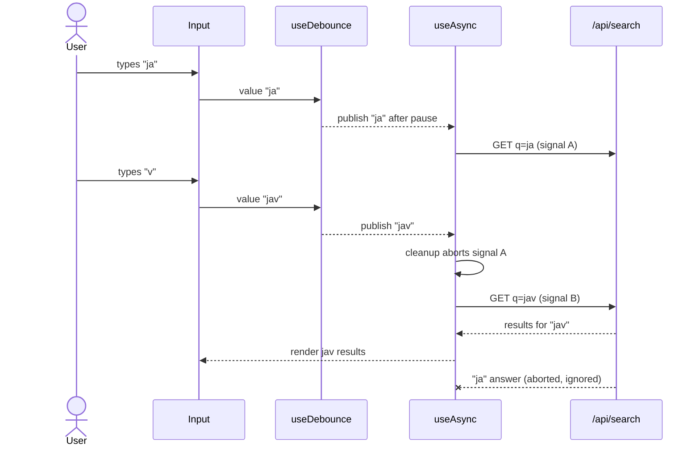

<!-- Generated by scripts/generate-docs.ts from src/catalog. Do not edit by hand. -->

# Search with cancellation

> Search-as-you-type that debounces input, aborts stale requests and can never show an older response.

🟡 intermediate · React 18.0+ · Real-World Scenarios › Data & networking

**Playground:** `npm run dev` → [`#/entry/search-with-cancellation`](http://localhost:5173/#/entry/search-with-cancellation)

## Concept

The input stays instant; `useDebounce` publishes the trimmed query once typing pauses, and `useAsync` runs one `fetchJson` per published query with an `AbortSignal`. A new query aborts the previous request, and a superseded run can never set state.

## Problem

`/api/search` answers _shorter_ queries more slowly, so typing “ja” then “jav” makes the “ja” response arrive last. Without cancellation it overwrites the newer results — the classic stale-response race — and every keystroke costs a request.

## When to use

- Search boxes, autocomplete, filters that query a server.
- Any input-driven request where only the latest answer matters.

## When not to use

- Filtering data you already have in memory: filter during render (with `useDeferredValue` if it is slow).
- Search results shared across screens or worth caching: use TanStack Query with the query in the key.

## Implementation

- [`src/examples/scenarios/search-with-cancellation/SearchWithCancellationScenario.tsx`](../../src/examples/scenarios/search-with-cancellation/SearchWithCancellationScenario.tsx)
- [`src/examples/scenarios/search-with-cancellation/searchApi.ts`](../../src/examples/scenarios/search-with-cancellation/searchApi.ts)
- [`src/hooks/timing/useDebounce.ts`](../../src/hooks/timing/useDebounce.ts)
- [`src/hooks/async/useAsync.ts`](../../src/hooks/async/useAsync.ts)
- [`src/hooks/async/fetchJson.ts`](../../src/hooks/async/fetchJson.ts)

## Interactive example

- [`src/examples/scenarios/search-with-cancellation/SearchWithCancellationScenario.tsx`](../../src/examples/scenarios/search-with-cancellation/SearchWithCancellationScenario.tsx)

## Execution flow

1. Keystroke: `query` state updates and the input re-renders immediately.
2. `useDebounce` publishes the trimmed value after the selected delay; below 2 characters the request is disabled (`enabled: false`), which also aborts one in flight.
3. A new debounced value changes the `useAsync` deps: during that render the state is already `pending` (with the previous data kept for a calm UI), and the effect cleanup aborts the previous controller.
4. `fetchJson` rejects non-2xx answers with `HttpError` and the custom `parse` validates the body shape.
5. Only the latest run commits `success`/`error`; the polite `role="status"` paragraph announces “N results for …”.

## Diagram: Debounced fetch with cancellation

Two queries in flight: the older, slower one is aborted when the newer one starts, so its late answer is never rendered.

## Edge cases

- Debounce at 0 ms: every keystroke requests, and the log shows each stale request being aborted.
- Query “error” → HTTP 503 → an alert with a working Retry (`reload()`).
- A response with an unexpected shape is an error, not a crash.
- Typing back to the already-published query does not refetch.
- Unmount aborts the request in flight.

## Testing

MSW overrides make the earlier query slow (600 ms) and the later one fast; the test types “ja”, waits until that request starts, types “v”, and asserts the “jav” results stay after the stale response would have arrived and that the log recorded the abort. Other tests cover the single debounced request, minimum length, empty state, the 503 + retry and response validation.

- [`src/examples/scenarios/search-with-cancellation/SearchWithCancellationScenario.test.tsx`](../../src/examples/scenarios/search-with-cancellation/SearchWithCancellationScenario.test.tsx)

## Production considerations

- Cancel on the server too where possible (the abort only frees the client).
- Put the query in the URL (`?q=`) so results are shareable — this scenario keeps it local.
- Rate-limit or cache popular queries server-side; debounce is not a security control.

## Related

- [useDebounce](../custom-hooks/use-debounce.md)
- [useAsync](../custom-hooks/use-async.md)
- [useFetch](../custom-hooks/use-fetch.md)
- [useEffect — race conditions & AbortController](../built-in-hooks/use-effect-race-conditions.md)
- [MDN: AbortController](https://developer.mozilla.org/en-US/docs/Web/API/AbortController) (official docs)
- [react.dev: Fetching data in Effects](https://react.dev/reference/react/useEffect#fetching-data-with-effects) (official docs)
- [MDN: ARIA live regions](https://developer.mozilla.org/en-US/docs/Web/Accessibility/ARIA/Guides/Live_regions) (official docs)
