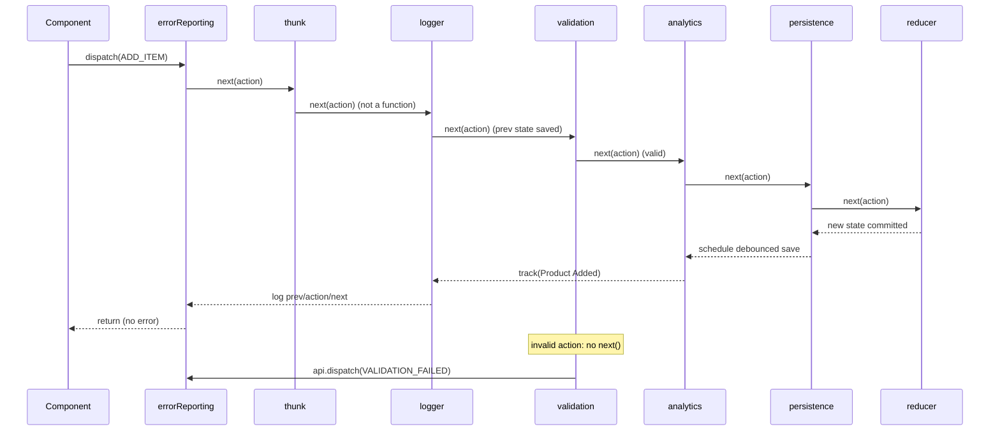

<!-- Generated by scripts/generate-docs.ts from src/catalog. Do not edit by hand. -->

# useReducer + dispatch middleware

> Logger, analytics, validation, thunk, error reporting and persistence composed around one reducer — toggle each and watch the pipeline.

🔴 advanced · React 18.0+ · State Management & Middleware › Reducers & middleware · support: universal

**Playground:** `npm run dev` → [`#/entry/reducer-middleware-pipeline`](http://localhost:5173/#/entry/reducer-middleware-pipeline)

## Concept

Middleware wrap `dispatch`: `(api) => (next) => (action) => { ...; next(action); ... }`. Each can inspect the action and state, perform side effects, swallow the action (not call `next`), transform it, or dispatch new actions through the whole chain with `api.dispatch`. The reducer stays pure. The library in `src/middleware/reducer/middleware/` provides six typed middleware (`Middleware<S, A>`), each with injected sinks so they are testable and can feed the screen.

## Problem

Cross-cutting concerns — logging, analytics, validation, async loading, error reporting, persistence — otherwise end up copied into every event handler or smuggled into reducers, which must stay pure. The original repository already used this pattern (e.g. `formValidationMiddleware`, `localStorageMiddleware`, `loginMiddleware` in `src/esp-demo`), but with `any`-typed dispatch and render-time state; this library generalises them with types and `getState()`. The esp-js integration (see the _ESP-JS Integration_ section, entry `esp-middleware-overview`) is one more middleware in the same chain that routes actions to an event router.

## When to use

- Concerns that apply to many actions: logging, analytics, persistence, error reporting.
- Rules that must hold for every dispatch, whoever dispatches: validation before the reducer.
- Async flows that should be visible as actions (`*_REQUESTED` / `*_LOADED` / `*_FAILED`).

## When not to use

- A single component with one effect: an event handler is clearer than a middleware.
- Server data with caching, dedupe and refetching: use TanStack Query or SWR instead of thunks.
- A large app that wants DevTools time travel, RTK Query and shared conventions: use Redux Toolkit (the same middleware contract).

## API

```ts
function useReducerWithMiddleware<S, A>(
  reducer: Reducer<S, A>,
  initialState: S,
  middleware?: ReadonlyArray<Middleware<S, A>>,
): readonly [state: S, dispatch: Dispatch<A>, store: ReducerStore<S, A>];
```

| Parameter                                                                                                | Type                                        | Description                                                                                                                                                                                           |
| -------------------------------------------------------------------------------------------------------- | ------------------------------------------- | ----------------------------------------------------------------------------------------------------------------------------------------------------------------------------------------------------- |
| `createLogger({ sink?, predicate?, now? })`                                                              | `Middleware<S, A>`                          | Emits `{ action, prevState, nextState, changed, durationMs }` after `next`. Default sink: collapsed (or expanded) console groups via `createConsoleSink`.                                             |
| `createAnalyticsMiddleware({ track, events, onError? })`                                                 | `Middleware<S, A>`                          | `events` maps action types to `(action, nextState, prevState) => AnalyticsEvent \| null`. Errors in mapping or `track` are caught.                                                                    |
| `createValidationMiddleware({ validators, onInvalid })`                                                  | `Middleware<S, A>`                          | Validators by action type return errors; on failure the action is swallowed and `onInvalid(errors, action)` is dispatched instead.                                                                    |
| `createThunkMiddleware(extra?)`                                                                          | `Middleware<S, ThunkActionOf<S, A, Extra>>` | Lets the store dispatch `(dispatch, getState, extra) => unknown`. The store action type is the union `A \| Thunk<S, A>`; use `isThunk` to narrow.                                                     |
| `createErrorReportingMiddleware({ report, toAction?, rethrow? })`                                        | `Middleware<S, A>`                          | Catches synchronous errors from later middleware and the reducer, reports them, optionally dispatches an error action.                                                                                |
| `createPersistenceMiddleware({ key, select, getStorage?, debounceMs?, serialize?, onSaved?, onError? })` | `PersistenceMiddleware<S, A>`               | Debounced save of a state slice; `flush()` / `cancel()` control the pending write. `onError` receives `unavailable`, `quota`, `write` and `serialize` errors. Pair with `hydrate({ key, validate })`. |

**Returns:** The current state, a stable `dispatch` that runs the chain, and the underlying store (`getState`, `dispatch`, `subscribe`).

## Implementation

- [`src/examples/state-management/pipeline/MiddlewarePipelineDemo.tsx`](../../src/examples/state-management/pipeline/MiddlewarePipelineDemo.tsx)
- [`src/examples/state-management/pipeline/cart.ts`](../../src/examples/state-management/pipeline/cart.ts)
- [`src/examples/state-management/pipeline/pipelineTrace.ts`](../../src/examples/state-management/pipeline/pipelineTrace.ts)
- [`src/middleware/reducer/middleware/logger.ts`](../../src/middleware/reducer/middleware/logger.ts)
- [`src/middleware/reducer/middleware/analytics.ts`](../../src/middleware/reducer/middleware/analytics.ts)
- [`src/middleware/reducer/middleware/validation.ts`](../../src/middleware/reducer/middleware/validation.ts)
- [`src/middleware/reducer/middleware/thunk.ts`](../../src/middleware/reducer/middleware/thunk.ts)
- [`src/middleware/reducer/middleware/errorReporting.ts`](../../src/middleware/reducer/middleware/errorReporting.ts)
- [`src/middleware/reducer/middleware/persistence.ts`](../../src/middleware/reducer/middleware/persistence.ts)
- [`src/middleware/reducer/middleware/actionTypes.ts`](../../src/middleware/reducer/middleware/actionTypes.ts)
- [`src/middleware/reducer/useReducerWithMiddleware.ts`](../../src/middleware/reducer/useReducerWithMiddleware.ts)
- [`src/middleware/reducer/createReducerStore.ts`](../../src/middleware/reducer/createReducerStore.ts)
- [`src/middleware/reducer/compose.ts`](../../src/middleware/reducer/compose.ts)
- [`src/middleware/reducer/types.ts`](../../src/middleware/reducer/types.ts)

## Interactive example

- [`src/examples/state-management/pipeline/MiddlewarePipelineDemo.tsx`](../../src/examples/state-management/pipeline/MiddlewarePipelineDemo.tsx)

## Execution flow

1. Setup (once, on mount): `applyMiddleware` calls each factory with `{ getState, dispatch }`, then chains them right-to-left so the first middleware is outermost.
2. Dispatch: the action enters middleware 1, which calls `next` → middleware 2 … → the reducer. Code after `next(action)` runs on the way back out and sees the new state via `getState()` synchronously.
3. The reducer runs outside React; if the state changed, subscribers are notified and `useSyncExternalStore` schedules a re-render.
4. `api.dispatch(action)` from inside a middleware (validation failure, thunk results, error actions) re-enters the chain from the top.
5. Recommended order (pinned by `ordering.test.ts`): errorReporting → thunk → logger → validation → analytics → persistence → reducer.
6. Unmount: the demo flushes the pending persistence write; nothing else holds timers or listeners.

## Diagram: Middleware execution order

A valid ADD_ITEM passes every middleware on the way in; code after next() runs on the way out, innermost first. An invalid action stops at validation, which dispatches VALIDATION_FAILED from the top of the chain.



## Common mistakes

### Throwing from a reducer to reject an action

❌ Incorrect:

```tsx
case 'ADD_ITEM':
  if (!action.name) throw new Error('Name required');
  return { ...state, items: [...state.items, action] };
```

Reducers should not throw: an exception aborts the dispatch, escapes into whatever called `dispatch` (an event handler, a timer) and nothing commits. Validate in middleware and dispatch a failure action; keep error reporting as a safety net for real bugs.

✅ Correct:

```tsx
createValidationMiddleware({
  validators: { ADD_ITEM: (a) => (a.name ? null : { name: 'Name required' }) },
  onInvalid: (errors) => ({ type: 'VALIDATION_FAILED', errors }),
});
```

### Reading state from the render closure

❌ Incorrect:

```tsx
const validate = (state, dispatch) => (action) => {
  if (state.items.length >= 5) return; // state captured at render time
  dispatch(action);
};
```

The original `formValidationMiddleware` received `state` from render, so two quick dispatches validated against stale state. `api.getState()` always returns the store’s current state.

### Putting the error reporter last

❌ Incorrect:

```tsx
useReducerWithMiddleware(reducer, initial, [logger, analytics, errorReporting]);
```

It can only catch what runs inside its `next`: the reducer, yes, but a throwing logger sink or analytics mapper placed before it escapes. Put it first.

### Expecting to await a thunk

❌ Incorrect:

```tsx
await dispatch(loadProducts()); // Dispatch<A> returns void
```

This store’s `dispatch` returns `void`, and a rejected promise is invisible to middleware. Thunks report outcomes by dispatching actions (or use Redux Toolkit, whose dispatch returns the thunk’s promise).

## Edge cases

- A validator rejecting the failure action itself would loop forever; the middleware throws a descriptive error instead.
- An error action that throws again is reported once more but not re-dispatched.
- Persistence: unchanged slices (`Object.is`) never schedule a write; a burst of changes produces one write; quota errors are reported as `quota` and the next change retries.
- Corrupt or outdated stored data fails `hydrate`’s `validate` guard and the default state is used.
- Middleware are captured on mount (like `createStore`). The demo toggles them through a wrapper that bypasses disabled stages, not by changing the array.

## Browser support

The store runs outside React and is read with `useSyncExternalStore`. Persistence resolves storage lazily, so creating the middleware on the server is safe.

## Testing

Each middleware has unit tests against `createReducerStore` with injected sinks and fake timers (persistence). `ordering.test.ts` traces a valid action, a rejected one, a thunk and reducer/middleware crashes through the full chain, and shows what changes when the order changes. The demo test drives the UI: the pipeline trace, the logger panel, analytics, validation on/off, the thunk against MSW, error reporting on/off and hydration.

- [`src/examples/state-management/pipeline/MiddlewarePipelineDemo.test.tsx`](../../src/examples/state-management/pipeline/MiddlewarePipelineDemo.test.tsx)
- [`src/middleware/reducer/middleware/ordering.test.ts`](../../src/middleware/reducer/middleware/ordering.test.ts)
- [`src/middleware/reducer/middleware/logger.test.ts`](../../src/middleware/reducer/middleware/logger.test.ts)
- [`src/middleware/reducer/middleware/analytics.test.ts`](../../src/middleware/reducer/middleware/analytics.test.ts)
- [`src/middleware/reducer/middleware/validation.test.ts`](../../src/middleware/reducer/middleware/validation.test.ts)
- [`src/middleware/reducer/middleware/thunk.test.ts`](../../src/middleware/reducer/middleware/thunk.test.ts)
- [`src/middleware/reducer/middleware/errorReporting.test.ts`](../../src/middleware/reducer/middleware/errorReporting.test.ts)
- [`src/middleware/reducer/middleware/persistence.test.ts`](../../src/middleware/reducer/middleware/persistence.test.ts)
- [`src/middleware/reducer/useReducerWithMiddleware.test.tsx`](../../src/middleware/reducer/useReducerWithMiddleware.test.tsx)

## Production considerations

- Keep middleware stateless or create them per store; the persistence middleware owns a timer per instance.
- Send analytics and error reports asynchronously and never let them throw into dispatch.
- Version persisted keys (`app:cart:v1`) and validate on hydrate.
- Log in development only, or behind a `predicate`, to avoid leaking state into production consoles.

## Related

- [Undo/redo reducer enhancer](undo-redo-reducer-enhancer.md)
- [External store + useSyncExternalStore](external-reducer-store.md)
- [Redux Toolkit + React Redux](redux-toolkit.md)
- [useLocalStorage](../custom-hooks/use-local-storage.md)
- [ESP-JS middleware for React hooks — architecture](../esp-js/esp-middleware-overview.md)
- [Redux: middleware](https://redux.js.org/understanding/history-and-design/middleware) (official docs)
- [useSyncExternalStore](https://react.dev/reference/react/useSyncExternalStore) (official docs)
- [useReducer](https://react.dev/reference/react/useReducer) (official docs)
